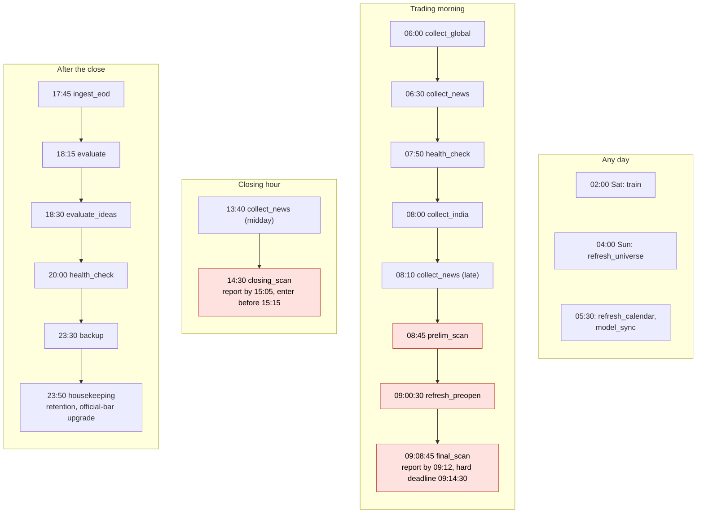

# MONSTER AI - NSE large-move intelligence engine

Every Indian trading morning at about 09:12 IST this system sends one Telegram report: the **top 5 liquid NSE stocks ranked by the
calibrated probability of an unusually large intraday range** (default: range > 3% of the open), with the evidence behind each name
(catalysts and how far they can be trusted, regime, F&O positioning, liquidity and cost), explicit uncertainty, and an honest
"no high-conviction setup" when nothing qualifies. After the close it evaluates what it predicted against simple baselines and
retrains weekly under fixed validation gates.

Every trading afternoon at about 14:31 IST it also sends a **closing-hour trade-idea report**: BTST ideas (buy before the close, sell
in the next session), swing ideas (hold a few sessions), bearish F&O setups and a watchlist of intraday levels for the next day, each
with a mechanical entry, stop and targets, the estimated cost and the reasons, built from NSE's live quotes and the stored history
(see [Closing-hour trade ideas](#closing-hour-trade-ideas)). Its scores rank setups; they are not probabilities.

> **Status: shadow mode.** The system never places orders. A model is only labelled `VALIDATED` when its out-of-sample
> calibration, skill versus the base rate and ranking edge over simple baselines pass fixed gates; until then every list is
> labelled SHADOW/BASELINE and tiers are capped at WATCH. The trade ideas are heuristic setups and say so until a list's live record
> passes its own gate. A wide intraday range is not a trade signal, and nothing here is investment advice. See
> [Limitations](#limitations).

## Contents

1. [At a glance](#at-a-glance)
2. [What you have to do](#what-you-have-to-do)
3. [How it works](#how-it-works)
4. [Whole-code architecture](#whole-code-architecture)
5. [Quick start (development machine)](#quick-start-development-machine)
6. [Server deployment](#server-deployment)
7. [Daily timetable](#daily-timetable-asiakolkata-trading-days)
8. [Closing-hour trade ideas](#closing-hour-trade-ideas)
9. [Commands](#commands)
10. [Configuration](#configuration)
11. [Reliability guarantees](#reliability-guarantees)
12. [Quality gates and CI/CD](#quality-gates-and-cicd)
13. [Project layout](#project-layout)
14. [Documentation map](#documentation-map)
15. [Limitations](#limitations)

## At a glance

| Area | What the system does for you, unattended |
|------|------------------------------------------|
| **Setup** | one command from your PC installs the OS packages, the virtualenv (binary wheels only), the unprivileged service user, the systemd units, the database and the first-time bootstrap (universe, 10 years of history, official bhavcopy, F&O, news, first models); native systemd, **no containers of any kind** |
| **Data collection** | every scraped source goes through one **curl_cffi** client (real browser TLS fingerprint) with adaptive per-source rate limiting, retries with back-off, circuit breakers and deadlines; bulk and conditional requests keep the request count low (official NSE files, Yahoo `spark` probe of 20 symbols per request, RSS `ETag` / 304) |
| **Any month, any year** | the NSE holiday calendar works without a code change in any year: shipped official list + daily NSE refresh + rule layer (fixed-date holidays, Good Friday) + live pre-open confirmation + operator overrides; health warns before a list runs out |
| **Any server time zone** | UTC storage, explicit IST market logic, a process zone pinned to UTC and a configurable log display zone; enforced by an AST guard and a five-zone matrix test |
| **Bounded storage** | every table, folder, cache, log and backup has a retention rule applied nightly, with disk-pressure windows, size budgets, `VACUUM` policy and a health check; `monster-ai storage` shows the usage |
| **Traceability** | daily log files per process role plus a shared errors file, millisecond stamps with offset, per-job tags, crash hooks, secret redaction, `monster-ai logs` / `diag`, and every frozen report stamped with the exact code that made it |
| **Self-healing** | resumable bootstrap, ledger-based scheduler (nothing runs twice, missed work is visible), RSS watchdog, systemd restart + watchdog + independent health timer, heartbeat file, queued alerts, automatic model rollback to a labelled baseline, verified backups |
| **Honesty** | calibrated probabilities, fixed gates, tier caps, sample sizes and 95 % intervals on every live statistic, explicit "no setup" |
| **Closing-hour ideas** | at 14:30 IST NSE's live quotes, laid over the stored daily history, become BTST, swing, bearish F&O and next-day intraday ideas with mechanical levels, costs and reasons; the report is frozen once, sent by 15:05 and judged against the official bars the same evening; every list shows its own live record and is only called validated after a fixed gate ([details](#closing-hour-trade-ideas)) |
| **Optional AI** | **Groq** (open-weight `openai/gpt-oss-120b`, with `gpt-oss-20b` and `qwen/qwen3.8-27b` behind it, each model with its own rate limits) reads news for structure and can **check unconfirmed company news on the web** (its built-in browser search); **Jev** (TypeSafe AI) judges event type, rumour, denial, severity and direction with calibrated confidence. Both are given the facts a human reader would use (when, by whom, which company and sector), are off until you add a key, are cached, budgeted and rate-limit aware, fall back to the rules on any failure and never change the calibrated forecast ([details](#optional-ai-groq-and-jev)) |

## What you have to do

Only this (everything else is automated, including first-time setup, history backfill, training, scheduling, restarts, storage
clean-up and the yearly holiday list):

1. Create a Telegram bot with [@BotFather](https://t.me/BotFather) and copy its token.
2. Run the one-command deployment (see [Server deployment](#server-deployment)). Optional keys (S3 backup, Groq / Jev AI)
   can be added later to `/etc/monster-ai/monster.env`; for the AI keys, restart the service and run `sudo monster-ai ai-test`
   (see [Optional AI](#optional-ai-groq-and-jev)).

After an **upgrade that changes the feature schema** (the release notes say so; `FEATURE_VERSION` is `fv2` today) the first `train`
run produces models for the new schema; until then the report says "heuristic baseline" - on a fresh install the bootstrap does this,
on an existing server the weekly Saturday training does it, and `sudo monster-ai train` just does it sooner.

## How it works


- **Data**: Yahoo daily bars (unofficial) and NSE official files (bhavcopy, UDiFF F&O, index lists, pre-open API), news from
  RSS/GDELT/NSE filings. Every source is registered with timestamp meaning, rate limits, licence notes, transport and failure
  behaviour ([docs/DATA_SOURCES.md](docs/DATA_SOURCES.md)).
- **Point-in-time by construction**: one feature builder serves training and live scoring; price/volume/F&O features are shifted
  by one session, global series use each market's own close-availability time at the scan cutoff, prices are on one split-adjusted
  basis, and tests perturb the future and the current session to prove nothing leaks.
- **Models**: specialist LightGBM models (technical, global, regime, F&O, events, direction) feed a meta-model; probabilities are
  isotonic calibrated on earlier data than the holdout. Two stages: `pre` (08:45) and `final` (with the opening gap).
- **Governance**: walk-forward training with embargo, fixed gates, champion/challenger, integrity-checked artifacts with
  rollback, heuristic baseline fallback, daily live evaluation with intervals and sample sizes.
- **Operations**: single-process scheduler daemon (systemd `Type=notify`, watchdog), one job at a time in memory-isolated child
  processes, per-job timeouts and RSS watchdog, health checks and Telegram alerts.

More diagrams (scan sequence, training flow, scheduler and bootstrap state machines, HTTP stack, calendar layers, time handling,
retention, logging, deployment topology) are in [docs/ARCHITECTURE.md](docs/ARCHITECTURE.md).

## Whole-code architecture

A layered modular monolith: each layer uses only the layers below it (the arrows to the outside world are the HTTPS calls), and every
layer also uses the platform package `app/`.


The module lists behind each box are in the package table of [docs/ARCHITECTURE.md](docs/ARCHITECTURE.md#packages).

## Quick start (development machine)

```bash
python -m venv .venv
.venv/bin/pip install -r requirements.txt -r requirements-dev.txt     # Windows: .venv\Scripts\pip ...
.venv/bin/python -m app.cli init            # database, calendar, source catalogue
.venv/bin/python -m app.cli doctor          # verifies Python, packages, paths, network, Telegram
.venv/bin/python -m pytest                  # hermetic unit/integration tests (no network)
.venv/bin/python -m app.cli bootstrap --skip-train   # real data: universe, 10y history, F&O (resumable)
.venv/bin/python -m app.cli scan --stage pre --dry-run   # prints the report; freezes and sends nothing
```

Python 3.10-3.13 on Linux x86-64/aarch64 (binary wheels only) and Windows for development.

## Server deployment

Target: Ubuntu 22.04/24.04 or Debian 12, 1 vCPU / **1 GB RAM** / 8 GB disk, **native systemd (no containers of any kind)**.
Put the bot token into a local `.env` (copy `.env.example`), then from your PC:

```powershell
.\deployment\deploy_remote.ps1 -Target ubuntu@203.0.113.10        # Windows
```
```bash
deployment/deploy_remote.sh ubuntu@203.0.113.10                   # Linux / macOS
sudo bash deployment/install.sh --env-file ./.env --yes           # or directly on the server
```

The installer is idempotent: it installs OS packages, creates the unprivileged `monster` user, builds the virtualenv from wheels
(including curl_cffi, which ships binary wheels for x86-64 and aarch64), validates the configuration, discovers your Telegram chat
id, initialises the database, installs and starts the systemd units, runs the first-time bootstrap in the background and verifies
the result; re-running it upgrades and rolls back automatically if the new release does not come up. The server's time zone does
not matter. Details: [deployment/README.md](deployment/README.md) and [docs/OPERATIONS.md](docs/OPERATIONS.md). On the server every
command is `sudo monster-ai <command>`.

## Daily timetable (Asia/Kolkata, trading days)



| Time | Job | Purpose |
|---|---|---|
| 06:00-08:30 | `collect_global` | US/Europe/Asia closes, FX, commodities, rates, VIX, GIFT Nifty (retries) |
| 06:30, 08:10, 13:40 | `collect_news` | RSS (conditional GET) + GDELT + NSE filings, entity/event extraction, market-reaction check; the 13:40 pass gives the closing scan fresh catalysts |
| 08:00 | `collect_india` | previous-session completeness (official bhavcopy first), results calendar |
| 08:45 | `prelim_scan` | preliminary scan, frozen snapshot (Telegram only if `SEND_PRELIM_REPORT=true`); first repairs the previous session if `collect_india` left it incomplete |
| 09:00:30 | `refresh_preopen` | NSE pre-open book (indicative/final equilibrium prices) |
| 09:08:45 | `final_scan` | final scan with the opening gap, frozen snapshot, **Telegram report by 09:12-09:14:30** |
| 14:30-15:00 | `closing_scan` | NSE live quotes over the stored history: BTST, swing, bearish F&O and next-day intraday ideas, frozen once, **Telegram report by 15:05** (enter before 15:15); retried every minute inside its window |
| 17:45+ | `ingest_eod` | official end-of-day data (retries until 23:30) |
| 18:15+ | `evaluate` | outcomes vs baselines, evening report with the live record |
| 18:30+ | `evaluate_ideas` | the earlier trade ideas judged on the official bars; outcomes are kept apart from the frozen reports and make up each list's live record |
| 23:30 / 23:50 | `backup`, `housekeeping` | verified online DB backup (+ off-box copy when S3 is configured); retention, official-bar upgrade, basis repair, DB maintenance |
| Sat 02:00 | `train` | walk-forward retraining, champion/challenger governance (`TRAINING_MODE=local-light`) |

Also every day at 05:30: `refresh_calendar` (NSE holidays) and `model_sync` (external training mode: pull and verify signed models).
Weekly: `refresh_universe` (Sun). Every 5 minutes an independent systemd timer runs `health --notify`. A ledger (`job_runs`) makes
every job restart-safe: missed windows are recorded and alerted, catch-up jobs run after a reboot, and nothing runs twice.

## Closing-hour trade ideas

Around 14:30 IST the market still has an hour to run and the day's story is mostly written, which is when a BTST (buy today, sell
tomorrow) or a swing trade is decided. `closing_scan` reads NSE's live quotes for the whole F&O segment in one request, lays them over
the stored daily history as the session in progress (open, high, low, last, volume projected to a full day), and sends one report by
15:05 with four lists, five names each by default:

| List | What it is | Exit rule the report states and the record judges |
|------|------------|-----------------------------------------------|
| **BTST** (long) | a strong close near the day's high on heavy volume, usually through the 20-day high in an uptrend | the first of the stop, the first target and the next close |
| **Swing** (long) | a pullback to the 20-day average, a base breakout or a tight range under the 20-day high inside a trend | the first of the stop, the first target and the 5th close |
| **Bearish** | the mirror images (BTST and swing); **F&O names only**, because the cash market cannot be held short overnight: short the future or buy a put | as above |
| **Watchlist** | names coiled at a key level, with a buy level above today's high and a sell level below today's low | intraday only: act on a break with volume, square off by 15:15 |

Every idea carries an entry reference with a "do not chase beyond" price, a stop, two targets and the reward to risk, all
**mechanical multiples of the previous ATR** (the stop sits at the nearer of the ATR multiple and the day's or week's extreme), the
estimated round-trip delivery cost and the reasons and cautions that moved its score. What the lists leave out on purpose: a name that
fails the liquidity, price or data gates, a stop wider than `IDEAS_MAX_RISK_PCT`, a reward to the second target smaller than 1.5 times
the risk, a cost above a quarter of the first target's reward, a BTST into a results announcement due today or tomorrow (a swing
into one is discounted), a BTST against a Nifty move of 2 % or more (no overnight long on a crash day, no overnight short on a surge
day) and a name with **confirmed bad news** for that side (rumours are only mentioned). Nothing is forced: on a day without a setup
the list says so.

**Honesty rules.**

- The **score ranks setups; it is not a probability** and is never drawn as one. It is a weighted mean of fixed, documented
  components; nothing is fitted.
- Each list shows its own **live record**: how the earlier ideas of that list did after costs (positive share, mean, first target and
  stop rates), with the number of ideas and days and a 95 % interval. A list is called validated only when it has at least 60 judged
  ideas over 20 days and both the win-rate and the mean-return intervals clear their no-edge level; until then every list says
  *not validated* and what it still needs.
- The report is **frozen once** per trading day (`ideas:run:<date>` in the key-value store) and re-sent unchanged after a failed
  delivery. Outcomes are judged by `evaluate_ideas` on the official end-of-day bars and stored apart (`ideas:out:<date>`): what was
  said is never edited, what happened is attached. A report built after the 15:05 deadline is withheld unless forced, is marked *late*
  at its top and never counts toward the record.
- It **fails visibly**: no live quotes, quotes that are not from today, a gap in the stored history or too few names with a complete
  row stop the scan with an alert (and a notice on the last attempt); nothing is guessed from older prices. A name whose price basis
  differs from the stored history (an ex-date today) is left out.
- Volume at 14:30 is a **projection** with a typical intraday profile, and the report says so. Stops, targets and costs are
  estimates; the system never places orders.

Commands: `sudo monster-ai ideas --dry-run` prints today's report and freezes and sends nothing; `sudo monster-ai ideas` runs the
scheduled job now; `--force` scans again only while the frozen report was never delivered and also sends after the deadline;
`sudo monster-ai telegram-preview --only ideas` shows a sample of the message with made-up data. The settings are `IDEAS_*`
(see [Configuration](#configuration)); `IDEAS_ENABLED=false` switches the whole feature off and `SEND_IDEAS_REPORT=false` keeps it
computing, freezing and evaluating silently.

## Commands

`python -m app.cli <command>` (on the server: `sudo monster-ai <command>`):

| Command | Purpose |
|---------|---------|
| `init` | create directories, migrate the database, seed the calendar |
| `doctor [--offline] [--json]` | verify the machine: configuration, permissions, disk, RAM, clock, feed reachability |
| `bootstrap [--resume] [--skip-train]` | first-run setup (resumable) |
| `daemon` | run the scheduler (systemd does this) |
| `run-job NAME [--key K] [--force] [--dry-run] [--opt K=V]`, `jobs` | run one job now; show the timetable and recent runs |
| `scan --stage pre\|final [--date D] [--dry-run] [--force]` | run a scan now (`--dry-run` prints the report, freezes and sends nothing) |
| `ideas [--date D] [--dry-run] [--force]` | run the closing-hour trade-idea scan now (`--dry-run` prints the report, freezes and sends nothing; `--force` scans again only while the frozen report was never delivered, and sends after the 15:05 deadline) |
| `evaluate [--date D]` | evaluate a day's predictions |
| `train [--stage pre\|final\|both] [--publish]` | train now (`--publish`: CI worker mode) |
| `backtest [--stage S] [--years N] [--out FILE]` | walk-forward evaluation against the baselines |
| `models list\|approve V\|activate V\|rollback [--stage S] [--status shadow\|validated]` | model governance |
| `backup [--verify \| --restore-latest [--remote]]` | back up, verify or restore the database |
| `health [--json] [--notify]` | exit 0 ok / 1 warnings / 2 critical |
| `storage [--prune [--dry-run] [--vacuum]] [--json]` | disk usage, row counts, retention windows; apply the retention now |
| `logs [--role R] [--date D] [-n N] [--level L] [--job J] [--grep T] [--since 90m] [--follow] [--list]` | read, filter and follow the daily logs (default: today's warnings and errors of every process) |
| `diag` | write a redacted diagnostics bundle (`diag-<UTC>.tar.gz`) for a bug report |
| `telegram-setup`, `telegram-test`, `telegram-preview` | discover the chat id; send a test message; send one sample of every message type (made-up data, marked *SAMPLE PREVIEW*) |
| `ai-test [--service llm\|web\|jev] [--list-only] [--json]` | check the Groq / Jev keys: lists the models the key can use, then sends one made-up news item through the real code (and makes one real web search when the web check is on) and prints the answer or why not (`--list-only` spends no tokens and makes no search) |
| `dashboard` | optional read-only web view |
| `env-example`, `version` | print the documented `.env` template; print the version and the running code fingerprint |
| `alert-unit UNIT` | internal: the systemd `OnFailure=` hook |

## Configuration

All settings are environment variables (12-factor), validated at start-up. `.env.example` is generated from the single source
of truth in `app/config.py` (`python scripts/generate_docs.py`). Only `TELEGRAM_BOT_TOKEN` / `TELEGRAM_CHAT_ID` are required.

| Group | Key knobs (defaults) |
|-------|----------------------|
| Mode and universe | `MONSTER_MODE` (shadow), `UNIVERSE_MODE` (fno_nifty100), `HISTORY_YEARS` (10) |
| Prediction | `PRIMARY_THRESHOLD` (3.0), `TOP_N` (5), `RANGE_THRESHOLDS`, `UNUSUAL_K`, tier probabilities (`TIER_*_P`) |
| Schedule | `PRELIM_SCAN_TIME`, `FINAL_SCAN_TIME`, `REPORT_CUTOFF_TIME`, `REPORT_DEADLINE_TIME` |
| Closing-hour ideas | `IDEAS_ENABLED` (true), `SEND_IDEAS_REPORT` (true), `IDEAS_REPORT_DEADLINE_TIME` (15:05), `IDEAS_ENTRY_BY_TIME` (15:15), `IDEAS_TOP_N` (5 per list), `IDEAS_MIN_SCORE` (60), `IDEAS_MAX_RISK_PCT` (4), `IDEAS_INCLUDE_SHORTS` (true) |
| Network | `HTTP_TRANSPORT` (auto: curl_cffi, falls back to requests), `HTTP_IMPERSONATE` (chrome), `HTTP_TIMEOUT_SEC` (30), `HTTP_MAX_ATTEMPTS` (4), `HTTP_MAX_RESPONSE_MB` (40), `YAHOO_MIN_INTERVAL_SEC` (1.0), `NSE_MIN_INTERVAL_SEC` (1.0), `NSE_ENABLED`, `GDELT_ENABLED` |
| Time | `MONSTER_TIMEZONE` (Asia/Kolkata) - the zone of **log stamps only**; market logic is always IST and the process zone is UTC |
| Retention and storage | `DATA_MAX_MB` (4000), `NEWS_RETENTION_DAYS` (45), `EVENT_RETENTION_DAYS` (1100), `QUOTE_RETENTION_DAYS` (400), `RECORD_RETENTION_DAYS` (1825), `OPS_RETENTION_DAYS` (180), `BACKUP_KEEP_DAILY` (7), `BACKUP_KEEP_WEEKLY` (4), `BACKUP_MAX_MB` (1500) |
| Logging | `LOG_LEVEL` (INFO), `LOG_FORMAT` (text or json), `LOG_RETENTION_DAYS` (30), `LOG_MAX_MB` (150) |
| Resources | `MIN_FREE_DISK_MB_WARN` / `_CRIT`, `JOB_MAX_RSS_MB` (720) |
| Training | `TRAINING_MODE` (`local-light`, `external` signed models, or `disabled`), `MODEL_SIGNING_KEY`, S3 storage for off-box backups and model bundles |
| Optional | Groq LLM (`GROQ_API_KEY`; `LLM_*` to tune it, including the model chain `LLM_MODEL`, `LLM_FALLBACK_MODEL`, `LLM_FALLBACK_MODELS`, or to use another provider; `LLM_WEB_SEARCH` / `LLM_WEB_MAX_PER_RUN` / `LLM_WEB_MAX_PER_DAY` for the web check), Jev (`TYPESAFE_API_KEY`, `JEV_*`), dashboard (`DASHBOARD_*`), backup encryption (`BACKUP_PASSPHRASE`) |

### Optional AI: Groq and Jev

Both are **off until you add a key**; with no key the deterministic rules do everything and no request is ever made.

| | Groq LLM | Jev (TypeSafe AI) |
|---|---|---|
| Key | `GROQ_API_KEY` ([console.groq.com](https://console.groq.com)) | `TYPESAFE_API_KEY` ([typesafe.ai](https://typesafe.ai)) |
| Model | `openai/gpt-oss-120b`, then `openai/gpt-oss-20b`, then `qwen/qwen3.8-27b` when the ones before it are rate-limited (`LLM_MODEL`, `LLM_FALLBACK_MODEL`, `LLM_FALLBACK_MODELS` override; see [the model chain](#the-model-chain-and-throughput-on-groqs-free-tier)) | `jev-1.14.0`, pinned (`JEV_MODEL`) |
| What it does | reads an article and returns event type, companies with a direction, severity, horizon, event time and a **verbatim evidence quote** | answers five typed questions about an article in one request: event type, rumour, denial, severity and direction for the company in focus, each with calibrated probabilities |
| What it is given | the whole stored text (up to 6,000 characters), the definition of every event type and a **context block** (see below) | the same text and the same facts as typed fields of its state |
| Web access | Groq's built-in `browser_search` for non-first-hand company news that matters (`LLM_WEB_SEARCH`, `LLM_WEB_MAX_PER_RUN`, `LLM_WEB_MAX_PER_DAY`), see [the web check](#the-web-check) | none: it judges what it is shown, including the web check's result |
| What it is not | a source of facts: a claim without a quote that appears word for word in the text is ignored | a price forecaster or a chat model: it judges news, it does not predict prices |
| Cost caps | `LLM_MAX_ARTICLES_PER_RUN` (60), `LLM_MAX_SECONDS_PER_RUN` (240), `LLM_WEB_MAX_PER_RUN` (8), `LLM_WEB_MAX_PER_DAY` (16) | `JEV_MAX_ITEMS_PER_RUN` (200), `JEV_MIN_CONFIDENCE` (0.5) |

Turn them on (the file edit is the only manual step; no code or container changes):

```bash
sudo nano /etc/monster-ai/monster.env     # set GROQ_API_KEY=... and / or TYPESAFE_API_KEY=...
sudo systemctl restart monster-ai
sudo monster-ai ai-test                   # one made-up item (and one web search) through the real code: OK, or exactly why not
```

How to think about them:

- **They improve how news is read, not the price forecast.** The calibrated P(range > 3 %) is computed from prices, F&O, global and
  calendar features; news is evidence shown beside it (catalysts, rumour flags, chains, "already priced in"). The AI makes that
  evidence more accurate: it recognises events the rules cannot, flags rumours and denials, and gives a calibrated second opinion
  on severity and direction. Where Groq and Jev disagree on a direction it is left unknown.
- **They are given the facts a human reader would use.** Besides the text, both get when the item was published and when it is being
  checked (in IST), the source and how far it can be trusted (exchange filing, official statement, company, wire, media, social),
  the filing category and issuer with its sector, and the companies the entity matcher found; the LLM also gets the definition of
  every event type. That is what lets them resolve "yesterday", tell a first-hand filing from an anonymous-source story and judge
  a direction for the right company. They are **never** given prices, returns or the rules' own verdict: the AI is meant to be an
  independent second reader, and a price would let it explain a move instead of reading the news. More context makes wrong
  readings rarer, it cannot make them impossible, which is why every answer is still validated (the quote must appear word for
  word, a choice must be an allowed option, a confidence must pass its threshold) and the rules remain the fallback.
- **They can never block or corrupt a report.** Results are cached for 14 days by text and context; each news job has a call and a time budget (a
  backlog drained in several batches shares it); a
  provider's `Retry-After` is honoured, a rate-limited Groq model hands over to the next model of the chain, an exhausted quota starts a
  cooldown that survives between runs, and a rejected key stops the service for the run. Any failure falls back to the rules, the
  report's coverage note names the degraded service, and `monster-ai health` warns after repeated failures.
- **Only public news text leaves the server** (headline, the article text, the context facts above and a company name): never keys,
  positions or predictions. `GROQ_API_KEY` is never sent to any other endpoint: an endpoint counts as Groq's only when its URL is
  exactly `https://api.groq.com...` (a look-alike host such as `api.groq.com.evil.example`, a URL with credentials or a backslash
  is refused or treated as another provider that never gets the Groq key).
- **Everything is traceable:** `monster-ai ai-test`, the `llm.*` / `llmweb.*` / `jev.*` counters in `monster-ai diag`, per-run counts in
  `news.last_run`, one row per service in `source_health`, what the web check found in the event's evidence, and WARNING lines in
  the logs with the reason (never the key).

#### The web check

Groq's `gpt-oss` models can search the web through a built-in, server-side tool (`browser_search`). MONSTER AI uses it for one
purpose: to settle whether an unconfirmed-looking company story is true, denied or old, before the extraction and Jev judge it.

- **Which items.** News about a listed company that is not first-hand (never an exchange filing, an official statement or the company's
  own release) and that is either a rumour the rules already flagged or a deal, order, fund-raising, court / regulator or management
  story with enough severity to matter. Macro and sector news, a story in which no listed company is named, results and dividends
  are reported everywhere or have nothing to look up, and are never searched for.
- **What it returns.** A small JSON brief, validated field by field before it is used: do independent outlets report the same
  facts (yes / no / unclear), how many, was a denial or correction found, was the event already public, up to three short facts and
  the host names relied on. The brief is checked against what the search really did: Groq returns the pages the tool read, and a
  cited source the search never returned is dropped, the outlet count cannot exceed the sites actually seen, and a "fact" that
  tries to instruct the reader is thrown away.
- **What it changes.** Both readers get the brief as context. By itself it changes one thing only: a **verified denial** turns the
  item into a rumour with a denial's discounts (half the severity, a halved direction, the rumour horizon). "Verified" means a page
  of a reputable publisher (an exchange, an official body, a wire service, a business newspaper, as the source registry knows them)
  that the search returned *and* the reply cites contains the wording of a denial; a denial the model merely asserts, or one found
  only on an unknown site, an aggregator or social media, never discounts an item (the readers are still told, marked unverified).
  A confirmation never raises anything, and what was found is kept in the event's evidence so you can see why a flag was set.
- **Why a separate request.** Groq documents that browser search cannot be combined with structured outputs, so a search request
  cannot also force the strict JSON schema the extraction relies on. Kept apart, the extraction stays schema-constrained.
- **What it costs.** Measured on a live key: a search takes 4 to 10 seconds and is the most expensive call there is: about 7,000
  tokens (4,000 to 12,000: the pages the tool reads count as input tokens), charged to Groq's per-minute **and** per-day token
  limits. It has its own caps (`LLM_WEB_MAX_PER_RUN`, 8 per news job, and `LLM_WEB_MAX_PER_DAY`, 16 per IST day over every job, retry
  and manual run), its own share of the time box (30 %, a hard bound: no request may run past it, so it needs
  `LLM_MAX_SECONDS_PER_RUN` of at least 34), cache (1 day), circuit breaker and cooldown, so a failing search never affects the
  extraction. It shares Groq's per-model token quota with the extraction: when that quota is spent the request goes to the fallback
  model, and when both are limited the item is judged without the search. **It works on Groq's free tier**, where a model has 200,000
  tokens a day, so about 28 searches use up a model's whole day: that is what the daily cap protects the extraction from. If an
  account's plan refuses it (HTTP 413, or a model without the tool) the check backs off for 6 hours and every item is judged without
  it. A gpt-oss model sometimes delivers its answer as a call to a tool that does not exist (HTTP 400 `tool_use_failed`, about one
  search in six in testing): the answer is then read from the error when it has the shape of a brief (unverified, so it can inform
  but never discount an item), otherwise the search is retried once; it never switches the check off. Set `LLM_WEB_SEARCH=false` to
  switch it off.
- **Point in time.** The web of today is not the web of last year: the check runs only in the live pipeline, never in a replay or a
  backtest, and its result is cached for one day only.

#### Text that tries to instruct the AI

A news item is untrusted input, and what a feed publishes can be written by anyone. An item whose text addresses the AI (for example
"ignore all previous instructions", a `SYSTEM:` line, a chat-template token, "set severity to 1", a closing `</article>` tag) is
**withheld from every AI service**: the rules still read it and it still becomes an event, but nothing of it is sent to Groq, Jev or
the web search. It is logged as a WARNING and counted in the news job's message (`N withheld (instruction-like text)`). The
detector is deliberately narrow so that ordinary regulatory news ("the court overruled the earlier directives") is not flagged. As a
second line of defence the prompt tells the model to treat such text as an attack, every answer is validated, and Jev only ever
sees the text as data in a typed field.

#### The model chain and throughput on Groq's free tier

Groq applies its rate limits **per model**, so a chain of models multiplies what the free tier allows. The extractor walks the chain
`openai/gpt-oss-120b` -> `openai/gpt-oss-20b` -> `qwen/qwen3.8-27b` (the first two are the configured model and its fallback; the third is
the default further fallback): a model that answers 429 is parked until its own limit resets and the next model takes the item, the
best available model is used again as soon as it is free, and a model that does not exist for the account, was retired or is blocked
for it (HTTP 404 / 403) is dropped for the run without stopping the others. Only when every model is limited does a news job wait, and
only for the first one to recover (at most 30 seconds); otherwise it stops and the rest of the batch is read by the rules and Jev, as
before. Qwen is run in its plain (non-thinking) mode and any `<think>` block is stripped; the web check stays on the `gpt-oss` models,
the only ones with Groq's browser tool.

Measured: 8,000 tokens per minute and 200,000 tokens per day for each of these models, about 2,000 tokens per extraction (the prompt
carries the definition of every event type), so roughly four extractions per minute and about a hundred a day per model, and three
times that with the whole chain: about twelve a minute and three hundred a day. A news job of 60 articles needed about seven minutes
with two models and needs about five with three; the 240-second time box (`LLM_MAX_SECONDS_PER_RUN`) now reaches about 48 articles
instead of about 32, and whatever it does not reach is read by the rules and Jev, which has its own limits. A web check costs as many
tokens as three or four extractions, which is why it has a daily cap. Groq's paid Developer tier raises these limits; nothing else
changes.

`LLM_FALLBACK_MODELS` sets the further models (comma or space separated, tried in order after `LLM_FALLBACK_MODEL`; `none` keeps the
chain to the first two). Add any other model your key can use, for instance a limited-preview model your account has been given
access to; `monster-ai ai-test --list-only` shows which models of the chain the key can see (a model it does not list is a warning,
not an error: the extractor skips it when Groq refuses it). Another provider (`LLM_API_BASE` + `LLM_MODEL`) gets only the models it is
told about.

## Reliability guarantees

The full explanation, with diagrams, is in [docs/ARCHITECTURE.md](docs/ARCHITECTURE.md); the operator view is in
[docs/OPERATIONS.md](docs/OPERATIONS.md).

- **Rate limits and scraping.** One `HttpClient` for every provider: curl_cffi with a browser TLS/HTTP-2 fingerprint, adaptive
  spacing that doubles after a 429 and eases back, `Retry-After`, exponential back-off with jitter, a circuit breaker, caller
  deadlines, HTTPS only and a response-size cap. Requests are batched or made conditional wherever the provider allows it.
- **Months and years.** The holiday calendar needs no yearly maintenance: official list (shipped and refreshed daily) -> rule layer
  (fixed-date holidays, Good Friday) -> live confirmation from the pre-open book -> operator overrides. Health warns 21 days
  before the official list ends; NSE publishes the next one in December.
- **Time zones.** Instants are stored in UTC; every market-time computation names IST explicitly; the process zone is pinned to
  UTC; only log stamps use `MONSTER_TIMEZONE`. A server in any zone, with any DST rule, behaves identically.
- **No unbounded growth.** The nightly `housekeeping` job applies a retention rule to every table, folder, cache, log and backup
  (see [Configuration](#configuration)); windows shrink under disk pressure; the data directory has a budget that health watches;
  `monster-ai storage` shows where the space is.
- **Tracing a bug.** `monster-ai logs` (errors of every process by default; filter by level, job, text or time; `--follow`),
  `monster-ai diag` (redacted bundle), `monster-ai version` (code fingerprint), and the `code_version` stored with every frozen
  report and model.
- **Failure handling.** Degradation is visible, never silent: see the degradation matrix in
  [docs/ARCHITECTURE.md](docs/ARCHITECTURE.md#degradation-matrix) and the alert table in [docs/OPERATIONS.md](docs/OPERATIONS.md#alerts-and-what-to-do).

## Quality gates and CI/CD

```bash
python -m pytest --cov --cov-fail-under=80        # >= 80% coverage, hermetic (injected clock, fake HTTP, temp directories)
python -m ruff check .                            # lint (incl. security rules)
shellcheck -x deployment/*.sh deployment/lib/*.sh # deployment scripts (also bash -n)
python scripts/generate_docs.py                   # regenerates .env.example and docs/DATA_SOURCES.md (tests fail on drift)
```

`.github/workflows/ci.yml` runs lint and the tests with the coverage gate on Python 3.10, 3.12 and 3.13, ShellCheck, `bash -n`,
an LF-only check of the deployment files, a PowerShell parse check and a **binary-wheel guard** (every pinned requirement must
resolve to wheels on linux x86-64 and aarch64, so the 1 GB server never compiles anything). `train.yml` can train and publish a
signed model bundle (`TRAINING_MODE=external`) for servers too small to train locally. The suite also guards time-zone safety
(an AST scan and a five-zone matrix), documentation drift (generated files, diagram syntax) and the deployment contract.

## Project layout

```
app/            configuration, clock, logging (redaction, daily files), log viewer, diagnostics, locks, resources, CLI, doctor
database/       SQLite (WAL) schema + migrations, repository (Store), backup/restore, object store
ingestion/      curl_cffi HTTP client, Yahoo, NSE, F&O, universe, news, freshness gate, split-basis repair
features/       point-in-time feature engines + builder + loader, and the closing-hour swing features
models/         training, calibration, inference, registry, artifacts, signing
ranking/        eligibility, costs, tiers, abstention, evidence, and the closing-hour trade ideas
automation/     calendar, scan, closing-hour ideas, jobs, scheduler, schedule engine, health, bootstrap, retention
notifications/  Telegram client, report renderers and their emoji style, sample previews, idempotent delivery
news_intelligence/, event_graph/   event extraction (rules + optional Groq / Jev), entity resolution, causal-graph propagation
backtesting/    metrics, walk-forward report, live evaluation and live record, trade-idea outcomes
dashboard/      optional read-only web UI (loopback)
deployment/     installer, systemd units, logrotate / journald config, remote deploy
scripts/        documentation generator
docs/           architecture, operations, data sources, blueprint traceability
data/seeds/     universe, holidays, feeds, aliases, graph seed
tests/          hermetic tests built on real captured provider responses
```

## Documentation map

| Document | Read it for |
|----------|-------------|
| [docs/ARCHITECTURE.md](docs/ARCHITECTURE.md) | the design with 20 diagrams: context, whole-code architecture, data flow, scan sequence, news and the optional AI services, training, scheduler, HTTP stack, calendar, time zones, retention, logging, deployment |
| [docs/OPERATIONS.md](docs/OPERATIONS.md) | the runbook: first day, commands, alerts and what to do, playbooks, backups and recovery, yearly and monthly notes, reading reports honestly |
| [deployment/README.md](deployment/README.md) | installing, upgrading, rolling back, uninstalling, troubleshooting, security, resource budget, external training |
| [docs/DATA_SOURCES.md](docs/DATA_SOURCES.md) | every data source: endpoint, transport, fetch strategy, rate limits, licence, failure behaviour (generated) |
| [docs/BLUEPRINT_TRACEABILITY.md](docs/BLUEPRINT_TRACEABILITY.md) | every requirement of the original blueprint, where it is implemented and its status |
| [CHANGELOG.md](CHANGELOG.md) | release notes |
| [.env.example](.env.example) | every configuration variable (generated) |

## Limitations

- Free endpoints (Yahoo, NSE JSON, public RSS/GDELT) are unofficial: they can change, rate-limit or block datacentre IPs. curl_cffi
  makes the client look like a browser but is no guarantee. The system degrades visibly (data-quality banner, preliminary model,
  abstention) instead of guessing. Confirm provider terms before any commercial use and prefer a licensed feed for production.
- The universe is today's F&O + Nifty 100 membership plus the delisted or quarantined names the database holds; names it never
  ingested stay absent (residual survivorship bias). Vendor-adjusted prices precede the official-file period.
- Calibrated probabilities describe *range*, not direction or profit. Costs are modelled estimates.
- The closing-hour trade ideas are **heuristics**, not a model: their scores rank setups, their stops and targets are mechanical ATR
  multiples, and nothing says yet that they make money. The live record in each report starts empty; a list is only called
  validated after 60 judged ideas over 20 days with intervals that clear no-edge. At 14:30 volume is a projection, an overnight (BTST)
  position carries gap risk that a stop does not cover, a bearish idea needs an F&O position, and a trade on a thin day can be filled
  away from the reference entry. The report is research output, not advice.
- NSE's live-quote endpoints are unofficial and changed in 2026 (the old `equity-stockIndices` is gone; the F&O list now comes from
  `equity-stockIndex`, index lists from `equity-stock-indices`, and the client tries the names in that order). The parser was run on a
  live NSE answer of 2 Nov 2026 (218 F&O rows, every field present) **after** the session, and `allIndices` on the live site too; the
  14:30-15:05 window itself has not run live. The per-stock `lastUpdateTime` of those answers is a placeholder, so freshness rests on the
  answer's own timestamp.
- News features reach the report (catalysts, chains, "priced in") but are not model inputs, and VWAP is a daily proxy: see the
  deviations in [docs/ARCHITECTURE.md](docs/ARCHITECTURE.md#deviations-from-the-blueprint). The optional Groq and Jev services
  make that news evidence more accurate; they do not change the calibrated forecast. They were verified against live Groq and Jev keys
  (see the CHANGELOG) and the size of the LLM's direction is noisy even so; run `sudo monster-ai ai-test` after adding the keys on a
  server.
- The rules that read news are keywords and patterns. Words found only in an article's body can no longer make a high-severity event
  (see [the architecture notes](docs/ARCHITECTURE.md#news-intelligence-and-the-optional-ai-services)), but a headline the rules misread
  outright still gets a wrong type; the optional AI services correct what their budgets cover, and none of it reaches the model.
- The live evidence base starts empty: statistics are shown with sample sizes and intervals and the "VALIDATED" label has to be earned.
  The measured edge over the best simple baseline is real but modest.
- The Linux installer and systemd units were validated by static analysis, stubs and ShellCheck on a Windows development machine:
  the first real morning on a server is their first live test. The NSE pre-open and GIFT Nifty parsers, which had only seen recorded
  fixtures, were run on live NSE payloads on 2 Nov 2026 (2 411 pre-open rows, every field present), but after the session: the
  09:00-09:12 polling window itself has not run live.
- Lunar-calendar exchange holidays of a year whose official list is not yet published are confirmed live on the day (the system sends no
  report and tells you), not predicted.

## Release notes

See [CHANGELOG.md](CHANGELOG.md).
