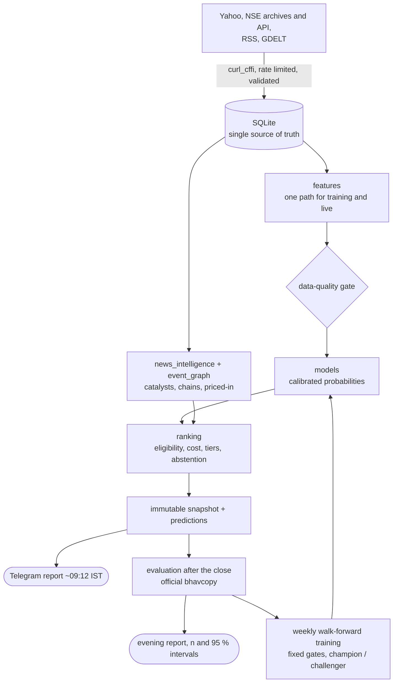
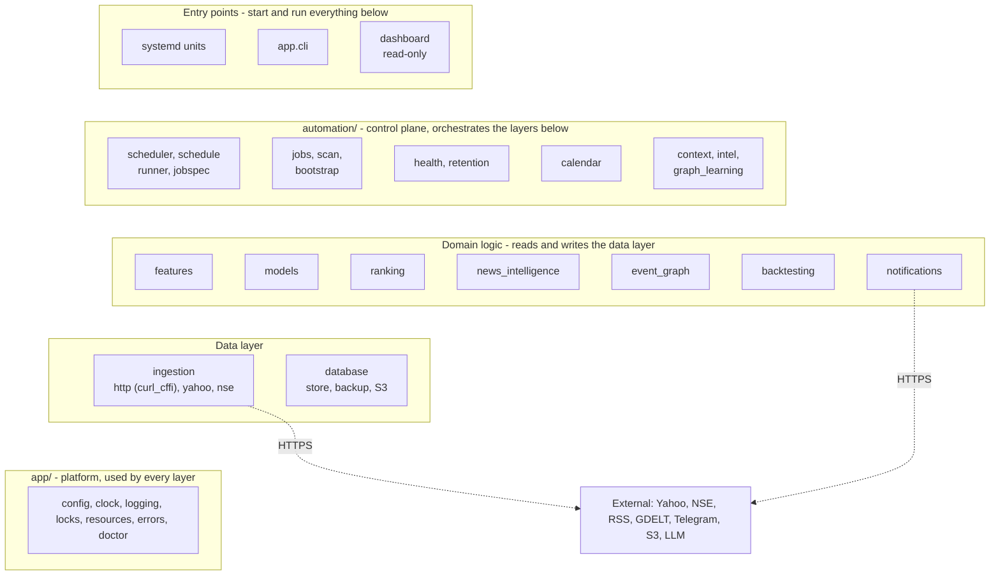
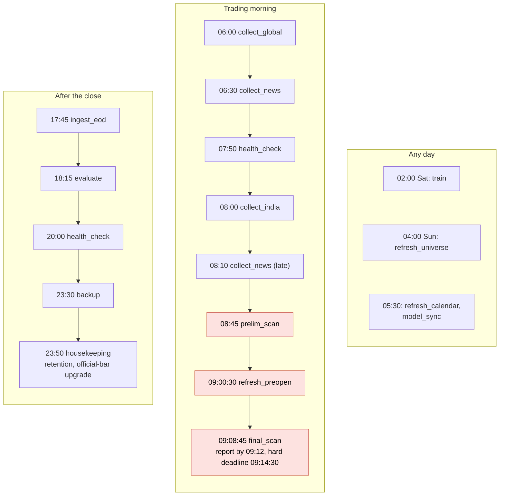

# MONSTER AI - NSE large-move intelligence engine

Every Indian trading morning at about 09:12 IST this system sends one Telegram report: the **top 5 liquid NSE stocks ranked by the
calibrated probability of an unusually large intraday range** (default: range > 3% of the open), with the evidence behind each name
(catalysts and how far they can be trusted, regime, F&O positioning, liquidity and cost), explicit uncertainty, and an honest
"no high-conviction setup" when nothing qualifies. After the close it evaluates what it predicted against simple baselines and
retrains weekly under fixed validation gates.

> **Status: shadow mode.** The system never places orders. A model is only labelled `VALIDATED` when its out-of-sample
> calibration, skill versus the base rate and ranking edge over simple baselines pass fixed gates; until then every list is
> labelled SHADOW/BASELINE and tiers are capped at WATCH. A wide intraday range is not a trade signal, and nothing here is
> investment advice. See [Limitations](#limitations).

## Contents

1. [At a glance](#at-a-glance)
2. [What you have to do](#what-you-have-to-do)
3. [How it works](#how-it-works)
4. [Whole-code architecture](#whole-code-architecture)
5. [Quick start (development machine)](#quick-start-development-machine)
6. [Server deployment](#server-deployment)
7. [Daily timetable](#daily-timetable-asiakolkata-trading-days)
8. [Commands](#commands)
9. [Configuration](#configuration)
10. [Reliability guarantees](#reliability-guarantees)
11. [Quality gates and CI/CD](#quality-gates-and-cicd)
12. [Project layout](#project-layout)
13. [Documentation map](#documentation-map)
14. [Limitations](#limitations)

## At a glance

| Area | What the system does for you, unattended |
|------|------------------------------------------|
| **Setup** | one command from your PC installs the OS packages, the virtualenv (binary wheels only), the unprivileged service user, the systemd units, the database and the first-time bootstrap (universe, 10 years of history, official bhavcopy, F&O, news, first models); native systemd, **no containers of any kind** |
| **Data collection** | every scraped source goes through one **curl_cffi** client (real browser TLS fingerprint) with adaptive per-source rate limiting, retries with back-off, circuit breakers and deadlines; bulk and conditional requests keep the request count low (official NSE files, Yahoo `spark` probe of 20 symbols per request, RSS `ETag` / 304) |
| **Any month, any year** | the NSE holiday calendar works without a code change in any year: shipped official list + daily NSE refresh + rule layer (fixed-date holidays, Good Friday) + live pre-open confirmation + operator overrides; health warns before a list runs out |
| **Any server time zone** | UTC storage, explicit IST market logic, a process zone pinned to UTC and a configurable log display zone; enforced by an AST guard and a five-zone matrix test |
| **Bounded storage** | every table, folder, cache, log and backup has a retention rule applied nightly, with disk-pressure windows, size budgets, `VACUUM` policy and a health check; `monster-ai storage` shows the usage |
| **Traceability** | daily log files per process role plus a shared errors file, millisecond stamps with offset, per-job tags, crash hooks, secret redaction, `monster-ai logs` / `diag`, and every frozen report stamped with the exact code that made it |
| **Self-healing** | resumable bootstrap, ledger-based scheduler (nothing runs twice, missed work is visible), RSS watchdog, systemd restart + watchdog + independent health timer, heartbeat file, queued alerts, automatic model rollback to a labelled baseline, verified backups |
| **Honesty** | calibrated probabilities, fixed gates, tier caps, sample sizes and 95 % intervals on every live statistic, explicit "no setup" |

## What you have to do

Only this (everything else is automated, including first-time setup, history backfill, training, scheduling, restarts, storage
clean-up and the yearly holiday list):

1. Create a Telegram bot with [@BotFather](https://t.me/BotFather) and copy its token.
2. Run the one-command deployment (see [Server deployment](#server-deployment)). Optional keys (S3 backup, LLM extraction)
   can be added later to `/etc/monster-ai/monster.env`.

After an **upgrade that changes the feature schema** (the release notes say so; `FEATURE_VERSION` is `fv2` today) the first `train`
run produces models for the new schema; until then the report says "heuristic baseline" - on a fresh install the bootstrap does this,
on an existing server the weekly Saturday training does it, and `sudo monster-ai train` just does it sooner.

## How it works



- **Data**: Yahoo daily bars (unofficial) and NSE official files (bhavcopy, UDiFF F&O, index lists, pre-open API), news from
  RSS/GDELT/NSE filings. Every source is registered with timestamp meaning, rate limits, licence notes, transport and failure
  behaviour ([docs/DATA_SOURCES.md](docs/DATA_SOURCES.md)).
- **Point-in-time by construction**: one feature builder serves training and live scoring; price/volume/F&O features are shifted
  by one session, global series use each market's own close-availability time at the scan cutoff, prices are on one split-adjusted
  basis, and tests perturb the future and the current session to prove nothing leaks.
- **Models**: specialist LightGBM models (technical, global, regime, F&O, events, direction) feed a meta-model; probabilities are
  isotonic calibrated on earlier data than the holdout. Two stages: `pre` (08:45) and `final` (with the opening gap).
- **Governance**: walk-forward training with embargo, fixed gates, champion/challenger, integrity-checked artifacts with
  rollback, heuristic baseline fallback, daily live evaluation with intervals and sample sizes.
- **Operations**: single-process scheduler daemon (systemd `Type=notify`, watchdog), one job at a time in memory-isolated child
  processes, per-job timeouts and RSS watchdog, health checks and Telegram alerts.

More diagrams (scan sequence, training flow, scheduler and bootstrap state machines, HTTP stack, calendar layers, time handling,
retention, logging, deployment topology) are in [docs/ARCHITECTURE.md](docs/ARCHITECTURE.md).

## Whole-code architecture

A layered modular monolith: each layer uses only the layers below it (the arrows to the outside world are the HTTPS calls), and every
layer also uses the platform package `app/`.



The module lists behind each box are in the package table of [docs/ARCHITECTURE.md](docs/ARCHITECTURE.md#packages).

## Quick start (development machine)

```bash
python -m venv .venv
.venv/bin/pip install -r requirements.txt -r requirements-dev.txt     # Windows: .venv\Scripts\pip ...
.venv/bin/python -m app.cli init            # database, calendar, source catalogue
.venv/bin/python -m app.cli doctor          # verifies Python, packages, paths, network, Telegram
.venv/bin/python -m pytest                  # hermetic unit/integration tests (no network)
.venv/bin/python -m app.cli bootstrap --skip-train   # real data: universe, 10y history, F&O (resumable)
.venv/bin/python -m app.cli scan --stage pre --dry-run   # prints the report; freezes and sends nothing
```

Python 3.10-3.13 on Linux x86-64/aarch64 (binary wheels only) and Windows for development.

## Server deployment

Target: Ubuntu 22.04/24.04 or Debian 12, 1 vCPU / **1 GB RAM** / 8 GB disk, **native systemd (no containers of any kind)**.
Put the bot token into a local `.env` (copy `.env.example`), then from your PC:

```powershell
.\deployment\deploy_remote.ps1 -Target ubuntu@203.0.113.10        # Windows
```
```bash
deployment/deploy_remote.sh ubuntu@203.0.113.10                   # Linux / macOS
sudo bash deployment/install.sh --env-file ./.env --yes           # or directly on the server
```

The installer is idempotent: it installs OS packages, creates the unprivileged `monster` user, builds the virtualenv from wheels
(including curl_cffi, which ships binary wheels for x86-64 and aarch64), validates the configuration, discovers your Telegram chat
id, initialises the database, installs and starts the systemd units, runs the first-time bootstrap in the background and verifies
the result; re-running it upgrades and rolls back automatically if the new release does not come up. The server's time zone does
not matter. Details: [deployment/README.md](deployment/README.md) and [docs/OPERATIONS.md](docs/OPERATIONS.md). On the server every
command is `sudo monster-ai <command>`.

## Daily timetable (Asia/Kolkata, trading days)



| Time | Job | Purpose |
|---|---|---|
| 06:00-08:30 | `collect_global` | US/Europe/Asia closes, FX, commodities, rates, VIX, GIFT Nifty (retries) |
| 06:30, 08:10 | `collect_news` | RSS (conditional GET) + GDELT + NSE filings, entity/event extraction, market-reaction check |
| 08:00 | `collect_india` | previous-session completeness (official bhavcopy first), results calendar |
| 08:45 | `prelim_scan` | preliminary scan, frozen snapshot (Telegram only if `SEND_PRELIM_REPORT=true`); first repairs the previous session if `collect_india` left it incomplete |
| 09:00:30 | `refresh_preopen` | NSE pre-open book (indicative/final equilibrium prices) |
| 09:08:45 | `final_scan` | final scan with the opening gap, frozen snapshot, **Telegram report by 09:12-09:14:30** |
| 17:45+ | `ingest_eod` | official end-of-day data (retries until 23:30) |
| 18:15+ | `evaluate` | outcomes vs baselines, evening report with the live record |
| 23:30 / 23:50 | `backup`, `housekeeping` | verified online DB backup (+ off-box copy when S3 is configured); retention, official-bar upgrade, basis repair, DB maintenance |
| Sat 02:00 | `train` | walk-forward retraining, champion/challenger governance (`TRAINING_MODE=local-light`) |

Also every day at 05:30: `refresh_calendar` (NSE holidays) and `model_sync` (external training mode: pull and verify signed models).
Weekly: `refresh_universe` (Sun). Every 5 minutes an independent systemd timer runs `health --notify`. A ledger (`job_runs`) makes
every job restart-safe: missed windows are recorded and alerted, catch-up jobs run after a reboot, and nothing runs twice.

## Commands

`python -m app.cli <command>` (on the server: `sudo monster-ai <command>`):

| Command | Purpose |
|---------|---------|
| `init` | create directories, migrate the database, seed the calendar |
| `doctor [--offline] [--json]` | verify the machine: configuration, permissions, disk, RAM, clock, feed reachability |
| `bootstrap [--resume] [--skip-train]` | first-run setup (resumable) |
| `daemon` | run the scheduler (systemd does this) |
| `run-job NAME [--key K] [--force] [--dry-run] [--opt K=V]`, `jobs` | run one job now; show the timetable and recent runs |
| `scan --stage pre\|final [--date D] [--dry-run] [--force]` | run a scan now (`--dry-run` prints the report, freezes and sends nothing) |
| `evaluate [--date D]` | evaluate a day's predictions |
| `train [--stage pre\|final\|both] [--publish]` | train now (`--publish`: CI worker mode) |
| `backtest [--stage S] [--years N] [--out FILE]` | walk-forward evaluation against the baselines |
| `models list\|approve V\|activate V\|rollback [--stage S] [--status shadow\|validated]` | model governance |
| `backup [--verify \| --restore-latest [--remote]]` | back up, verify or restore the database |
| `health [--json] [--notify]` | exit 0 ok / 1 warnings / 2 critical |
| `storage [--prune [--dry-run] [--vacuum]] [--json]` | disk usage, row counts, retention windows; apply the retention now |
| `logs [--role R] [--date D] [-n N] [--level L] [--job J] [--grep T] [--since 90m] [--follow] [--list]` | read, filter and follow the daily logs (default: today's warnings and errors of every process) |
| `diag` | write a redacted diagnostics bundle (`diag-<UTC>.tar.gz`) for a bug report |
| `telegram-setup`, `telegram-test`, `telegram-preview` | discover the chat id; send a test message; send one sample of every message type (made-up data, marked *SAMPLE PREVIEW*) |
| `dashboard` | optional read-only web view |
| `env-example`, `version` | print the documented `.env` template; print the version and the running code fingerprint |
| `alert-unit UNIT` | internal: the systemd `OnFailure=` hook |

## Configuration

All settings are environment variables (12-factor), validated at start-up. `.env.example` is generated from the single source
of truth in `app/config.py` (`python scripts/generate_docs.py`). Only `TELEGRAM_BOT_TOKEN` / `TELEGRAM_CHAT_ID` are required.

| Group | Key knobs (defaults) |
|-------|----------------------|
| Mode and universe | `MONSTER_MODE` (shadow), `UNIVERSE_MODE` (fno_nifty100), `HISTORY_YEARS` (10) |
| Prediction | `PRIMARY_THRESHOLD` (3.0), `TOP_N` (5), `RANGE_THRESHOLDS`, `UNUSUAL_K`, tier probabilities (`TIER_*_P`) |
| Schedule | `PRELIM_SCAN_TIME`, `FINAL_SCAN_TIME`, `REPORT_CUTOFF_TIME`, `REPORT_DEADLINE_TIME` |
| Network | `HTTP_TRANSPORT` (auto: curl_cffi, falls back to requests), `HTTP_IMPERSONATE` (chrome), `HTTP_TIMEOUT_SEC` (30), `HTTP_MAX_ATTEMPTS` (4), `HTTP_MAX_RESPONSE_MB` (40), `YAHOO_MIN_INTERVAL_SEC` (1.0), `NSE_MIN_INTERVAL_SEC` (1.0), `NSE_ENABLED`, `GDELT_ENABLED` |
| Time | `MONSTER_TIMEZONE` (Asia/Kolkata) - the zone of **log stamps only**; market logic is always IST and the process zone is UTC |
| Retention and storage | `DATA_MAX_MB` (4000), `NEWS_RETENTION_DAYS` (45), `EVENT_RETENTION_DAYS` (1100), `QUOTE_RETENTION_DAYS` (400), `RECORD_RETENTION_DAYS` (1825), `OPS_RETENTION_DAYS` (180), `BACKUP_KEEP_DAILY` (7), `BACKUP_KEEP_WEEKLY` (4), `BACKUP_MAX_MB` (1500) |
| Logging | `LOG_LEVEL` (INFO), `LOG_FORMAT` (text or json), `LOG_RETENTION_DAYS` (30), `LOG_MAX_MB` (150) |
| Resources | `MIN_FREE_DISK_MB_WARN` / `_CRIT`, `JOB_MAX_RSS_MB` (720) |
| Training | `TRAINING_MODE` (`local-light`, `external` signed models, or `disabled`), `MODEL_SIGNING_KEY`, S3 storage for off-box backups and model bundles |
| Optional | LLM extraction (`LLM_*`), dashboard (`DASHBOARD_*`), backup encryption (`BACKUP_PASSPHRASE`) |

## Reliability guarantees

The full explanation, with diagrams, is in [docs/ARCHITECTURE.md](docs/ARCHITECTURE.md); the operator view is in
[docs/OPERATIONS.md](docs/OPERATIONS.md).

- **Rate limits and scraping.** One `HttpClient` for every provider: curl_cffi with a browser TLS/HTTP-2 fingerprint, adaptive
  spacing that doubles after a 429 and eases back, `Retry-After`, exponential back-off with jitter, a circuit breaker, caller
  deadlines, HTTPS only and a response-size cap. Requests are batched or made conditional wherever the provider allows it.
- **Months and years.** The holiday calendar needs no yearly maintenance: official list (shipped and refreshed daily) -> rule layer
  (fixed-date holidays, Good Friday) -> live confirmation from the pre-open book -> operator overrides. Health warns 21 days
  before the official list ends; NSE publishes the next one in December.
- **Time zones.** Instants are stored in UTC; every market-time computation names IST explicitly; the process zone is pinned to
  UTC; only log stamps use `MONSTER_TIMEZONE`. A server in any zone, with any DST rule, behaves identically.
- **No unbounded growth.** The nightly `housekeeping` job applies a retention rule to every table, folder, cache, log and backup
  (see [Configuration](#configuration)); windows shrink under disk pressure; the data directory has a budget that health watches;
  `monster-ai storage` shows where the space is.
- **Tracing a bug.** `monster-ai logs` (errors of every process by default; filter by level, job, text or time; `--follow`),
  `monster-ai diag` (redacted bundle), `monster-ai version` (code fingerprint), and the `code_version` stored with every frozen
  report and model.
- **Failure handling.** Degradation is visible, never silent: see the degradation matrix in
  [docs/ARCHITECTURE.md](docs/ARCHITECTURE.md#degradation-matrix) and the alert table in [docs/OPERATIONS.md](docs/OPERATIONS.md#alerts-and-what-to-do).

## Quality gates and CI/CD

```bash
python -m pytest --cov --cov-fail-under=80        # >= 80% coverage, hermetic (injected clock, fake HTTP, temp directories)
python -m ruff check .                            # lint (incl. security rules)
shellcheck -x deployment/*.sh deployment/lib/*.sh # deployment scripts (also bash -n)
python scripts/generate_docs.py                   # regenerates .env.example and docs/DATA_SOURCES.md (tests fail on drift)
```

`.github/workflows/ci.yml` runs lint and the tests with the coverage gate on Python 3.10, 3.12 and 3.13, ShellCheck, `bash -n`,
an LF-only check of the deployment files, a PowerShell parse check and a **binary-wheel guard** (every pinned requirement must
resolve to wheels on linux x86-64 and aarch64, so the 1 GB server never compiles anything). `train.yml` can train and publish a
signed model bundle (`TRAINING_MODE=external`) for servers too small to train locally. The suite also guards time-zone safety
(an AST scan and a five-zone matrix), documentation drift (generated files, diagram syntax) and the deployment contract.

## Project layout

```
app/            configuration, clock, logging (redaction, daily files), log viewer, diagnostics, locks, resources, CLI, doctor
database/       SQLite (WAL) schema + migrations, repository (Store), backup/restore, object store
ingestion/      curl_cffi HTTP client, Yahoo, NSE, F&O, universe, news, freshness gate, split-basis repair
features/       point-in-time feature engines + builder + loader
models/         training, calibration, inference, registry, artifacts, signing
ranking/        eligibility, costs, tiers, abstention, evidence
automation/     calendar, scan, jobs, scheduler, schedule engine, health, bootstrap, retention
notifications/  Telegram client, report renderers and their emoji style, sample previews, idempotent delivery
news_intelligence/, event_graph/   event extraction, entity resolution, causal-graph propagation
backtesting/    metrics, walk-forward report, live evaluation and live record
dashboard/      optional read-only web UI (loopback)
deployment/     installer, systemd units, logrotate / journald config, remote deploy
scripts/        documentation generator
docs/           architecture, operations, data sources, blueprint traceability
data/seeds/     universe, holidays, feeds, aliases, graph seed
tests/          hermetic tests built on real captured provider responses
```

## Documentation map

| Document | Read it for |
|----------|-------------|
| [docs/ARCHITECTURE.md](docs/ARCHITECTURE.md) | the design with 18 diagrams: context, whole-code architecture, data flow, scan sequence, training, scheduler, HTTP stack, calendar, time zones, retention, logging, deployment |
| [docs/OPERATIONS.md](docs/OPERATIONS.md) | the runbook: first day, commands, alerts and what to do, playbooks, backups and recovery, yearly and monthly notes, reading reports honestly |
| [deployment/README.md](deployment/README.md) | installing, upgrading, rolling back, uninstalling, troubleshooting, security, resource budget, external training |
| [docs/DATA_SOURCES.md](docs/DATA_SOURCES.md) | every data source: endpoint, transport, fetch strategy, rate limits, licence, failure behaviour (generated) |
| [docs/BLUEPRINT_TRACEABILITY.md](docs/BLUEPRINT_TRACEABILITY.md) | every requirement of the original blueprint, where it is implemented and its status |
| [CHANGELOG.md](CHANGELOG.md) | release notes |
| [.env.example](.env.example) | every configuration variable (generated) |

## Limitations

- Free endpoints (Yahoo, NSE JSON, public RSS/GDELT) are unofficial: they can change, rate-limit or block datacentre IPs. curl_cffi
  makes the client look like a browser but is no guarantee. The system degrades visibly (data-quality banner, preliminary model,
  abstention) instead of guessing. Confirm provider terms before any commercial use and prefer a licensed feed for production.
- The universe is today's F&O + Nifty 100 membership plus the delisted or quarantined names the database holds; names it never
  ingested stay absent (residual survivorship bias). Vendor-adjusted prices precede the official-file period.
- Calibrated probabilities describe *range*, not direction or profit. Costs are modelled estimates.
- News features reach the report (catalysts, chains, "priced in") but are not model inputs, and VWAP is a daily proxy: see the
  deviations in [docs/ARCHITECTURE.md](docs/ARCHITECTURE.md#deviations-from-the-blueprint).
- The live evidence base starts empty: statistics are shown with sample sizes and intervals and the "VALIDATED" label has to be earned.
  The measured edge over the best simple baseline is real but modest.
- The Linux installer and systemd units were validated by static analysis, stubs and ShellCheck on a Windows development machine, and
  the NSE pre-open parser against recorded fixtures: the first real morning on a server is the first live test of both.
- Lunar-calendar exchange holidays of a year whose official list is not yet published are confirmed live on the day (the system sends no
  report and tells you), not predicted.

## Release notes

See [CHANGELOG.md](CHANGELOG.md).
