# MONSTER AI - architecture

Large-move intelligence for NSE equities. Every trading morning it ranks the liquid names by the **calibrated
probability of an unusually large intraday range**, sends a Telegram report before the open, freezes the
predictions, scores them after the close and retrains under fixed gates.

**Shadow mode only.** The system never places, modifies or cancels an order and holds no trading credentials (the only broker value it
can hold is an optional read-only application token for market data, see [the broker feed](#the-optional-broker-feed); the broker's login
values may sit in a developer's local `.env`, but they are not settings, nothing reads them and the deploy scripts never upload them). Its
output is research. See [honesty rules](#honesty-rules).

Companion documents: [README](../README.md) (overview and quick start), [OPERATIONS](OPERATIONS.md) (runbook),
[deployment guide](../deployment/README.md), [DATA_SOURCES](DATA_SOURCES.md) (generated source catalogue) and
[BLUEPRINT_TRACEABILITY](BLUEPRINT_TRACEABILITY.md) (every requirement of the original design blueprint and where it lives).

## Contents

1. [System context](#system-context)
2. [Whole-code architecture](#whole-code-architecture)
3. [Data flow](#data-flow)
4. [Daily timeline](#daily-timeline)
5. [The scan, step by step](#the-scan-step-by-step)
6. [The 09:30 opening read](#the-0930-opening-read)
7. [The closing-hour trade ideas](#the-closing-hour-trade-ideas)
8. [News intelligence and the optional AI services](#news-intelligence-and-the-optional-ai-services)
9. [The optional broker feed](#the-optional-broker-feed)
10. [Packages](#packages)
11. [Point-in-time correctness](#point-in-time-correctness)
12. [Models and governance](#models-and-governance)
13. [Honesty rules](#honesty-rules)
14. [Scheduling and self-healing](#scheduling-and-self-healing)
15. [Network layer: curl_cffi, bulk fetching, rate limits](#network-layer-curl_cffi-bulk-fetching-rate-limits)
16. [Exchange calendar for any month and year](#exchange-calendar-for-any-month-and-year)
17. [Time zones](#time-zones)
18. [Storage and bounded retention](#storage-and-bounded-retention)
19. [Logging and diagnostics](#logging-and-diagnostics)
20. [Degradation matrix](#degradation-matrix)
21. [External training and off-box storage](#external-training-and-off-box-storage)
22. [Deployment topology](#deployment-topology)
23. [Security](#security)
24. [Resource budget](#resource-budget)
25. [Design decisions](#design-decisions)
26. [Deviations from the blueprint](#deviations-from-the-blueprint)

## System context

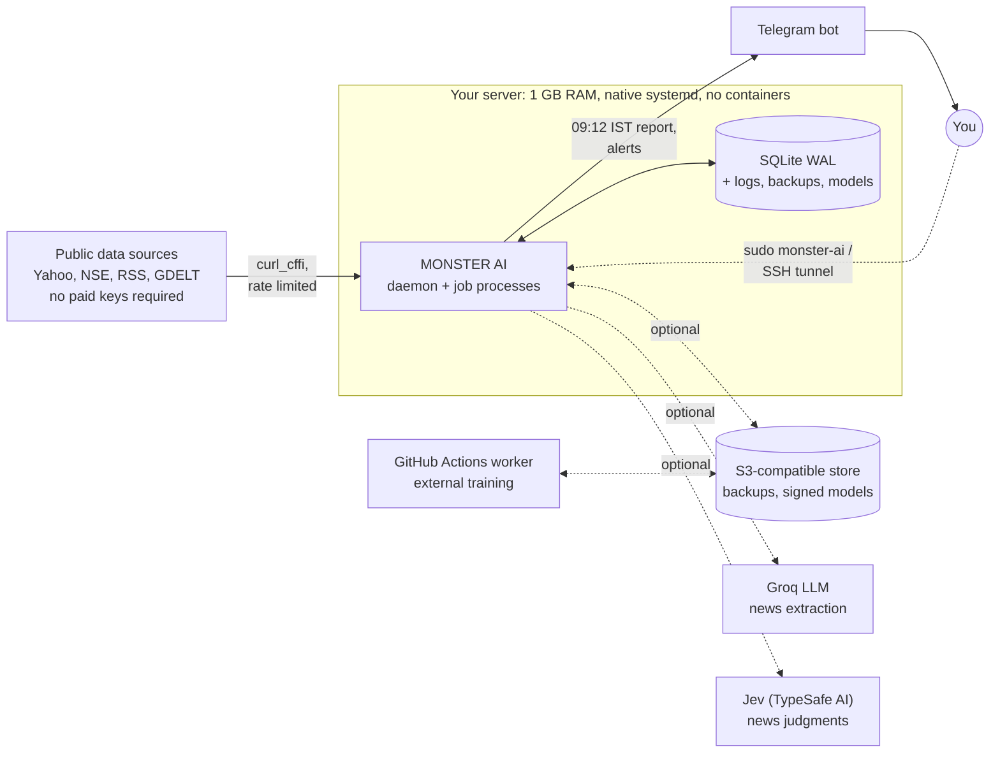

Everything the system knows lives in **one SQLite file**. There is no message bus, no container and no second process
holding state: a crash can only lose the work of the current job, and every job is safe to run again.

## Whole-code architecture

The code base is a layered modular monolith. Each layer uses only the layers below it (the arrows to the outside world are the
HTTPS calls), and every layer also uses the platform package `app/` (configuration, clock, logging). The module lists behind each
box are in the [package table](#packages) below.

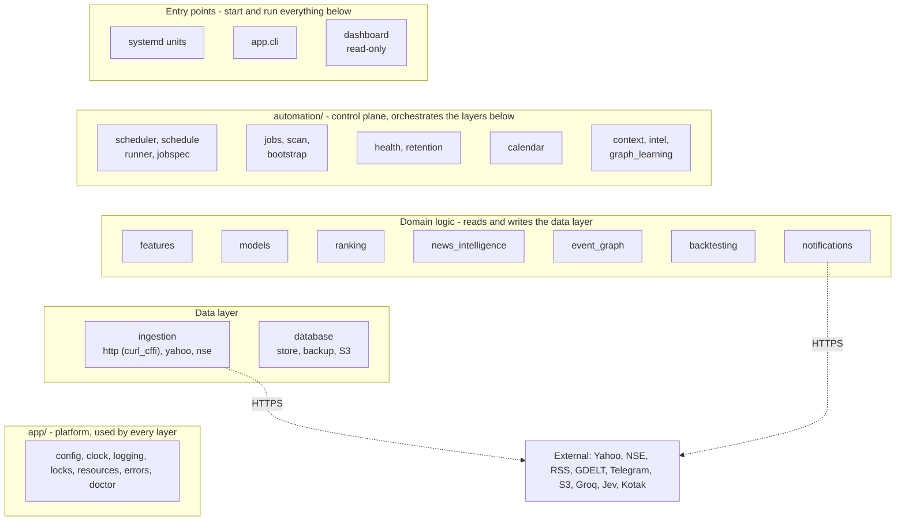

Dependency rules, checked against the import graph:

- `database` and `ranking` import nothing but `app`; `event_graph` imports only `database`; `notifications` imports only
  `ranking.types` and the list names of `backtesting.ideas` besides `app` (and Pillow, lazily, for the chart images).
- `features`, `ingestion` and `backtesting` use `automation.calendar` as a shared service (it is the only `automation`
  module a lower layer imports; `models.external` imports `automation.runner` lazily to run the model-sync job).
- Only `automation` and `app.cli` see every package; nothing below them imports upwards.
- The scheduler daemon never imports pandas, numpy, LightGBM or `requests`: jobs run in child processes, so the
  long-lived process stays small.

The control plane in more detail:

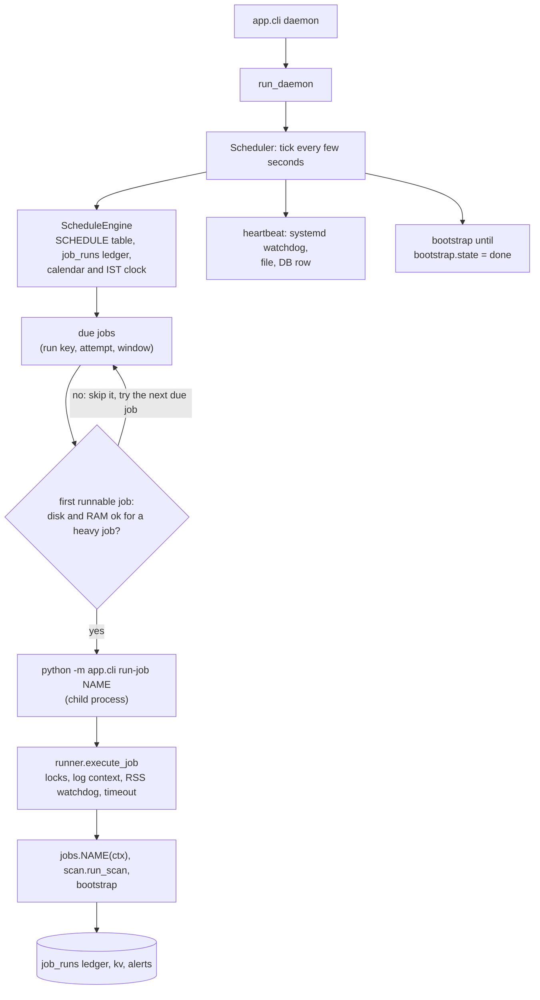

## Data flow

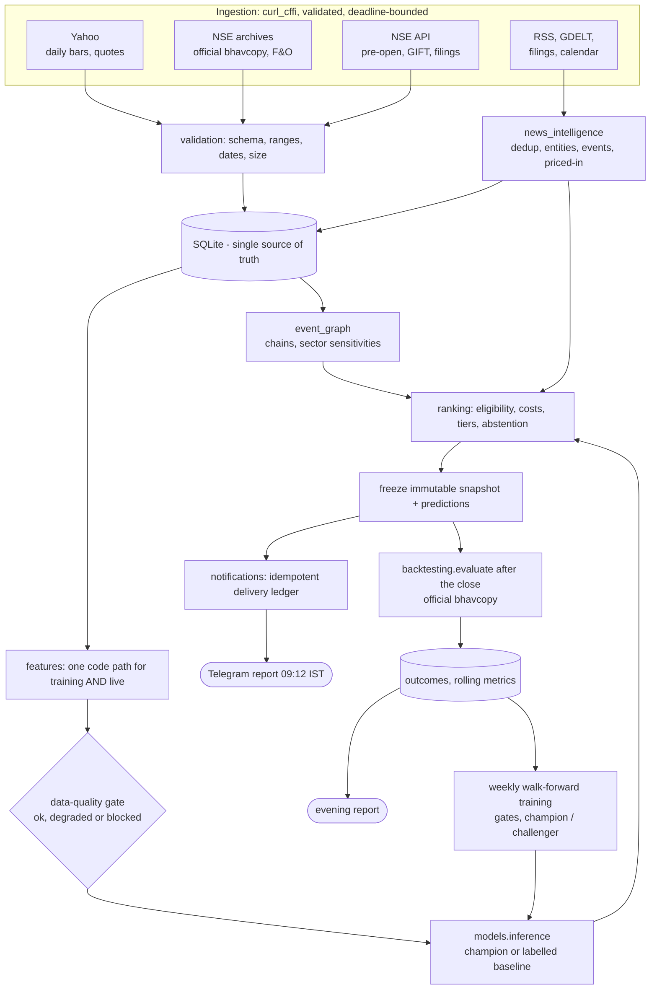

## Daily timeline

All times are Asia/Kolkata. The authoritative table is `SCHEDULE` in [automation/schedule.py](../automation/schedule.py);
the daemon derives "what is due" from the `job_runs` ledger, never from a clock tick.

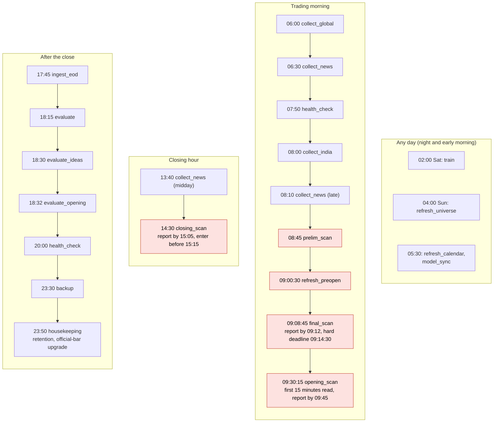

| Time | Job | Purpose |
|------|-----|---------|
| 06:00 | `collect_global` | global closes, live context, GIFT Nifty (retried until 08:30) |
| 06:30 / 08:10 / 13:40 | `collect_news` | RSS (conditional GET), global topic discovery (GDELT, with Google News search as its fallback), filings, board meetings, event extraction; the 13:40 pass gives the closing scan fresh catalysts |
| 07:50 | `health_check` | operational alerts (also 20:00) |
| 08:00 | `collect_india` | previous session completeness: official file first, Yahoo as repair |
| 08:45 | `prelim_scan` | preliminary scan (**critical**), silent unless `SEND_PRELIM_REPORT=true`; first repairs the previous session when `collect_india` left it below 90 % coverage; its snapshot is the fallback when the final scan is missing |
| 09:00:30 | `refresh_preopen` | NSE pre-open book (**critical**) |
| 09:08:45 | `final_scan` | final report with pre-open gaps, delivered by 09:12 (**critical**, hard deadline 09:14:30) |
| 09:30:15 | `opening_scan` | the opening read from NSE's live quotes after the third five-minute candle, delivered by 09:45 (**critical**, a try every 20 seconds until 09:44) |
| 14:30 | `closing_scan` | closing-hour trade ideas from NSE's live quotes, delivered by 15:05 (**critical**, a try every minute for the whole window until 15:00) |
| 17:45 | `ingest_eod` | official end-of-day files |
| 18:15 | `evaluate` | outcomes, metrics, evening report |
| 18:30 | `evaluate_ideas` | the earlier trade ideas judged on the official bars, outcomes stored apart from the frozen reports |
| 18:32 | `evaluate_opening` | the earlier opening reads judged on the official bars (every name the model scored) and, where Yahoo's five-minute feed reaches, the range ahead and the levels as a plan; outcomes stored apart from the frozen reports |
| 23:30 / 23:50 | `backup`, `housekeeping` | verified online backup (+ off-box copy); retention, official-bar upgrade, basis repair, DB maintenance |
| Sat 02:00 | `train` | walk-forward retraining (skipped in external mode) |
| Sun 04:00 | `refresh_universe` | index / F&O membership, history for new names, event-graph re-seeding and weekly re-estimation of its edge sensitivities |
| daily 05:30 | `refresh_calendar`, `model_sync` | holiday calendar; pull signed models in external mode |
| every 5 min | `monster-ai-health.timer` | independent health check (works even when the daemon is down) |

Critical jobs preempt non-critical ones. Non-trading days run only the "any day" jobs. Jobs marked `catch_up` still run
after their window (or on a later day) when the server was down.

## The scan, step by step

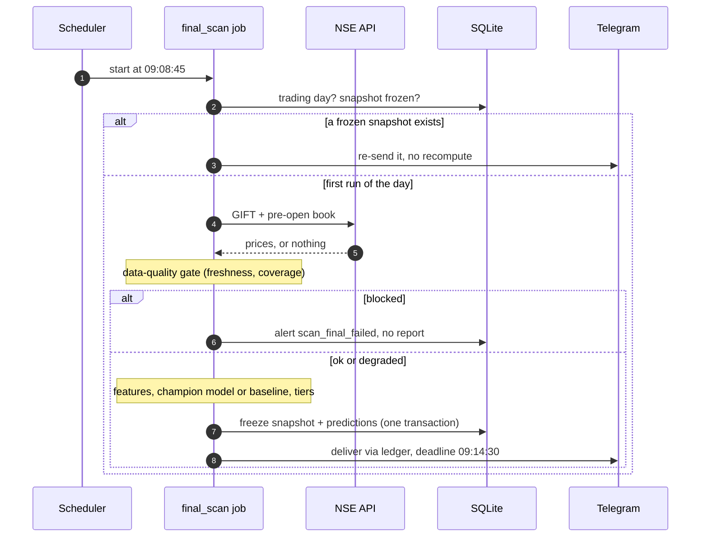

Key properties: the snapshot is frozen **before** delivery, so a Telegram outage can never lose or change a report; a
retry re-sends the frozen report; a report that would arrive after the deadline is withheld and an alert is queued; the
pre-open wait is bounded by the same deadline, so a slow provider cannot push the report past its cutoff.

## The 09:30 opening read

A third daily report, built at 09:30 IST once the first three five-minute candles have formed, from the same kinds of parts as the
closing-hour one: the stored daily history, a live feed, a frozen report, an idempotent delivery and an after-the-close evaluation.
Unlike the closing-hour ideas it does contain a model, but a deliberately small and transparent one, and the evidence for it was
measured before any threshold or coefficient was chosen (`ranking/opening.py` holds it in its docstring; README: *The 09:30 opening read*).

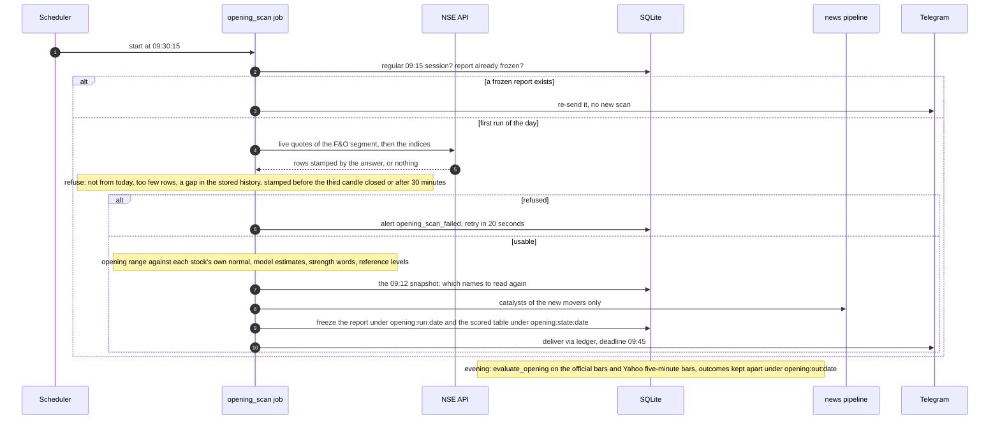

How it is built:

- **The opening range is the live row.** At 09:30 the day's high and low in NSE's quotes ARE the first fifteen minutes' range, so one
  request for the F&O segment (the same client and fallbacks as the closing scan, `automation.ideas.fetch_live`) is all the data the
  scan needs besides the stored history. The answer's own timestamp says how long the session had been trading: less than 14
  minutes means the third candle has not closed (the scan fails and retries every 20 seconds), more than 30 means it is no opening
  read any more (the scan does not run). In between, a late scan is normalised back to the fifteen-minute basis with the measured
  mean growth of the range (1.07 at 20 minutes, 1.14 at 25, 1.20 at 30) and the report says so.
- **History** (`ranking/opening.history_stats`): from the stored daily panel up to the previous session, per stock the mean daily range
  of the last 20 sessions (at least 15 of them), the 14-day Wilder ATR, the median traded value and the number of sessions of history.
  The completeness check of the stored history and the price-basis exclusion are the closing scan's (`automation.ideas.stored_panel`
  and `basis_exclusions`): a gap in the history stops the scan, a name whose previous close differs from the stored one by more than
  2 % (an ex-date) is left out of everything.
- **Model** (`ranking/opening.score`): four inputs (ln of the 20-session mean range, ln ATR %, the gap over the mean range, ln of the
  opening range over the mean range) into three logistic fits (day range above 2, 3 and 5 % of the open) and two log-linear fits
  with their residual quantiles (the day's range, and the range after the scan). Every input is clipped to the range it was fitted on.
  Two logical floors follow the fit: a level the range so far has passed has a chance of exactly 1 (more than rounding noise above it),
  and the day's range band never starts below the range so far. What was measured, on the names that had not yet passed 3 % (the
  range so far counts towards the day; the first, Yahoo-based study found 59 % of each day's top six already past it), on the
  broker's own five-minute candles of 138 sessions (28,982 stock-days, 118 sessions judged out of sample): AUC 0.695 for a range above 3 %
  on the 09:12 information and 0.763 with the opening range, the six highest-rated names made one in 80 % of cases (63 % on the 09:12
  information, 28 % random); for the range still to come the opening adds -2 to +2 points over the 09:12 information among hot
  openings, which is nothing; calibration slope 0.96 (26.1 % stated against 25.9 % real); the 80 % band held 79 %; no direction
  (earlier study) and no breakout edge (-0.20 % per trade after costs, -0.02 % before). The tests pin the shipped coefficients to an
  independent calculation (`tests/test_opening_model.py`).
- **Choosing** (`ranking/opening.build_ideas`): the names of the morning report (the frozen final snapshot, else the silent 08:45 one;
  a final scan that found no setup means no picks) are read again in their morning order whatever their estimate; new movers must pass
  the research's gates (liquid, priced, enough history, a sane gap, a round-trip cost below a quarter of the median range ahead) and
  have a HOT or EXPLOSIVE opening (`OPENING_MIN_X`, an opening range of at least 0.60 times the stock's mean daily range), and are
  ranked by the range still expected after the scan, not by the chance of a range above 3 % (which would put the names that have
  already passed it first and say nothing new). News is asked for exactly the movers' symbols, once.
- **Freeze once, never edit** (`automation/opening.py`): the report is stored under `opening:run:<date>` before delivery, the scored
  table of every eligible name under `opening:state:<date>` (with the range so far, which the record needs); a retry, a late run or
  `--force` re-sends the frozen report. A report built after the deadline is marked late and kept out of the record.
- **Evaluation** (`backtesting/opening.py`, `evaluate_opening`): the model is judged on every eligible name it scored (the frozen
  table), not only on the listed ones: the pooled stated chance against what happened and the top six against the base rate, both on
  the names whose range so far had not passed 3 % at the scan (the others are counted apart: their chance was 1 by construction), and
  the coverage of the 80 % band on every name; the listed names also on the range ahead and the levels as a plan from Yahoo's
  five-minute bars while they reach back (`YahooClient.fetch_intraday`; a bar that reaches both the stop and the target counts as
  stopped, a gap through a trigger fills at the open). An outcome judged on a provisional bar waits for the official one. The record
  passes its gate after 20 judged sessions with the pooled stated chance within 5 points of what happened and its top names clearly
  above the base rate.
- **Rendering and delivery** (`notifications/opening.py`, `NotificationService.send_opening`): the guarantees of the other reports
  (escaping, `n/a` for a missing figure, messages of at most 3,900 characters, an idempotent ledger) plus a head that says what the
  opening does and does not tell, "so far" and "still ahead" always apart, a probability always named with its threshold (a level
  already passed reads "already above 3 %", a band bounded by the range so far reads "at least"), and a report withheld after 09:45
  unless forced.

## The closing-hour trade ideas

A second daily report, built around 14:30 IST from the same kinds of parts: the stored daily history, a live feed, a frozen
report, an idempotent delivery and an after-the-close evaluation. It is **not** the calibrated model: the setups are heuristics with
mechanical levels, and the system says so until a list's live record passes its own gate (`backtesting/ideas.py`).

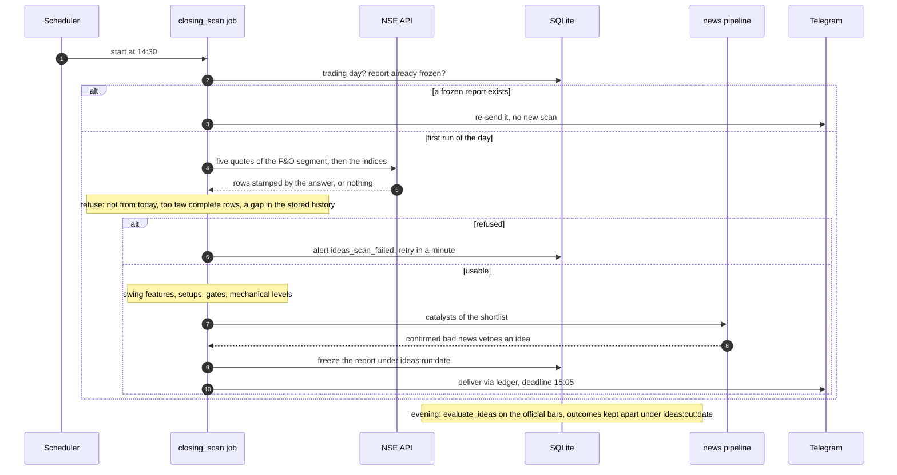

How it is built:

- **Live feed** (`ingestion/nse.py`, `ingestion/pipeline.py`): one request returns every F&O stock's running open, high, low, last price,
  previous close and volume, one more the indices. NSE renamed the list endpoint in 2026, so the client tries the current names first
  (`equity-stockIndex` for the F&O segment, `equity-stock-indices` for an index list, the retired `equity-stockIndices` last), moves on
  only on a 404 and remembers the name that answered; when none answers, the error names them and the scan's alert and notice carry
  it. The answer's own timestamp stamps every row (the per-stock `lastUpdateTime` is a placeholder) and a snapshot that is not from
  today is refused. The requests are bound by the report deadline while it is ahead; a run that starts after it (a manual or forced
  run, a preview) gets a budget of its own, because the HTTP client starts no attempt once its deadline has passed.
- **Features** (`features/swing.py`): the live row is laid over the stored history as the session in progress and the features are
  computed as of that session (unshifted, unlike the morning model's, which only ever sees the previous one). Volume is projected to a
  full day with a U-shaped intraday profile (an approximation the report states) and the ATR comes from the previous close.
  A name whose live previous close differs from the stored one by more than 2 % (an ex-date) is not in the day's table at all: its
  figures are meaningless (a split reads as -50 %) and would otherwise skew the sector peers, the breadth and the ranks of the rest.
  When more than 40 % of the names have no stored close or a different one, the stored history is not trusted and the scan stops.
- **Setups, gates and levels** (`ranking/ideas.py`): fixed, documented components become a 0-100 score per setup (BTST long and short,
  swing long and short, watchlist); gates cover liquidity, price, history, event dates, regime and a Nifty crash; stops and targets are
  multiples of the previous ATR with a structural stop and a minimum reward to risk; the estimated delivery cost must be small
  against the first target (`ranking/costs.py`); confirmed news can veto or discount an idea, a rumour is only mentioned. A results
  meeting on a weekend or a holiday counts like one announced after the close of the session before it (its news lands before the
  next open, the gap a BTST carries).
- **Freeze once, never edit** (`automation/ideas.py`): the report is stored under `ideas:run:<date>` before delivery and re-sent
  unchanged by a retry, a late run or `--force` (which only lifts the report deadline: the copy that goes out says it is late);
  a frozen report is never replaced. `evaluate_ideas` judges the ideas
  on the official bars (`backtesting/ideas.py`: the first of the stop, the first target and the end of the horizon, a gap through the
  stop exits at the open, the stop wins a day that touches both) and stores the outcomes under `ideas:out:<date>`; the live record
  of the next report is built from them, per list, with sample sizes and day-block bootstrap intervals, and a list passes its gate
  only with at least 60 judged ideas over 20 days and both intervals clear of no-edge.
- **Rendering and delivery** (`notifications/ideas.py`, `NotificationService.send_ideas`): the same guarantees as the other reports
  (escaping, `n/a` for a missing figure, messages of at most 3,900 characters, an idempotent ledger) plus a score that is never drawn
  as a probability and a report withheld after 15:05 unless forced (then marked late; one built after the deadline is also kept out of
  the record). The levels are repeated in two monospace tables at the top (at most 37 characters wide) and, after the text, two chart
  images follow (`notifications/charts.py`): the board and the trade plan.
- **More than one reader** (`NotificationService._deliver_extras`, setting `TELEGRAM_EXTRA_CHAT_IDS`): every report (prelim, final,
  evening, closing-hour ideas) goes to the main chat first and, once that delivery is recorded as sent, to each extra chat with the very
  same messages and the same deadline; alerts, failure notices and tests never do. Each extra chat has a ledger row of its own (kind
  `<report>_extra`, key `<report key>@<chat id>`), which keeps three things true: a person who blocked the bot cannot turn the main
  chat's delivery, or `health`'s look at the newest `final_report` row, into a failure; a chat that already has a message is never sent
  it twice; and a failure is one `telegram_extra_delivery_failed` warning per chat and day, never a failed report. The text reaches every
  chat before any image is drawn (once) or uploaded, so nobody waits for a picture. A report that is withheld or failed for the main
  chat goes to nobody; the rare crash between the main chat's record and the extras' sends loses only their copy (the report is then a
  duplicate and is not re-sent).
- **Chart images** (`notifications/canvas.py` draws, `notifications/charts.py` composes): Pillow draws each chart at twice its size and
  shrinks it once (smooth edges without a vector library; the built-in font has ASCII only, so every label is sanitised and the arrows
  are shapes). A chart is built from the same report object as the text and returned as bytes, a Telegram-HTML caption and the list of
  every label drawn (the tests read it to check what a chart claims). `NotificationService` builds and sends the images only
  after the text is delivered and recorded, within a 45-second budget, never for a late report, and any failure (no Pillow,
  `SEND_CHARTS=false`, a drawing error, a refused or slow upload) is logged and changes nothing about the delivery; the ledger knows
  the text only.

## News intelligence and the optional AI services

News is **evidence shown in the report, not a model input**: the LightGBM forecast of P(range > 3 %) is computed from prices,
F&O, global and calendar features only. The news layer decides which catalysts are listed for a name, how they are labelled
(event type, severity, rumour or denial, direction, source class) and which other stocks an event propagates to through the
event graph. Optional AI services sharpen that labelling; with no key set the deterministic rules do all of it and no request
is ever made.

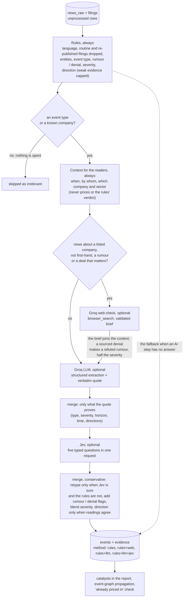

**What the rules decide first, before any AI is asked** (`news_intelligence/events.py`). Three rules came out of a live run on real
feeds and filings, in which 1 098 articles and 419 filings became 855 events:

- *A filing that only re-publishes an earlier one is dropped*: the newspaper copy of the results, the audio recording or the
  transcript of the call. The first-hand filing is the event; the copy only repeats its words. 31 of the 178 filings that became
  events were such copies (typed `earnings_result`, severity up to 0.6, and a third of Jev's calls). A routine notice (trading
  window, record date, schedule of a meet) that says nothing specific is dropped too.
- *A type resting on passing words in the body alone is a lead, not a headline*: nothing in the headline, no filing category behind
  it, and less than `WEAK_EVIDENCE_SCORE` (3.0) of rule weight, i.e. one or two rules. It keeps its type, which may still be right,
  but its severity is capped at `WEAK_EVIDENCE_SEVERITY` (0.35) and the event's rules say `weak_evidence`. About one article in
  seven was typed from a stray word: "escalation" in a power-demand story became a geopolitical conflict at severity 0.95, "divest"
  in a story about FII selling an acquisition at 0.9.
- *A company-type event whose text names no listed company gets the same cap* (`cap_unattributed`, rule `no_listed_company`):
  "GST collections jump 22.9%" is not a company's results, and without the cap it was the top catalyst for five of sixteen
  unrelated stocks.

Exchange filings, official statements and a company's own releases are never capped, and a verified AI answer can still raise a
severity the rules capped.

All three services (the extraction, the web check and Jev) run behind the same safety rails (`news_intelligence/remote.py`), each with
its own budget, circuit breaker, cooldown, cache and health row, so a slow, rate-limited or broken provider can only make the rules
do the work, never delay the morning schedule or lose an item, and a failing web check never touches the extraction:

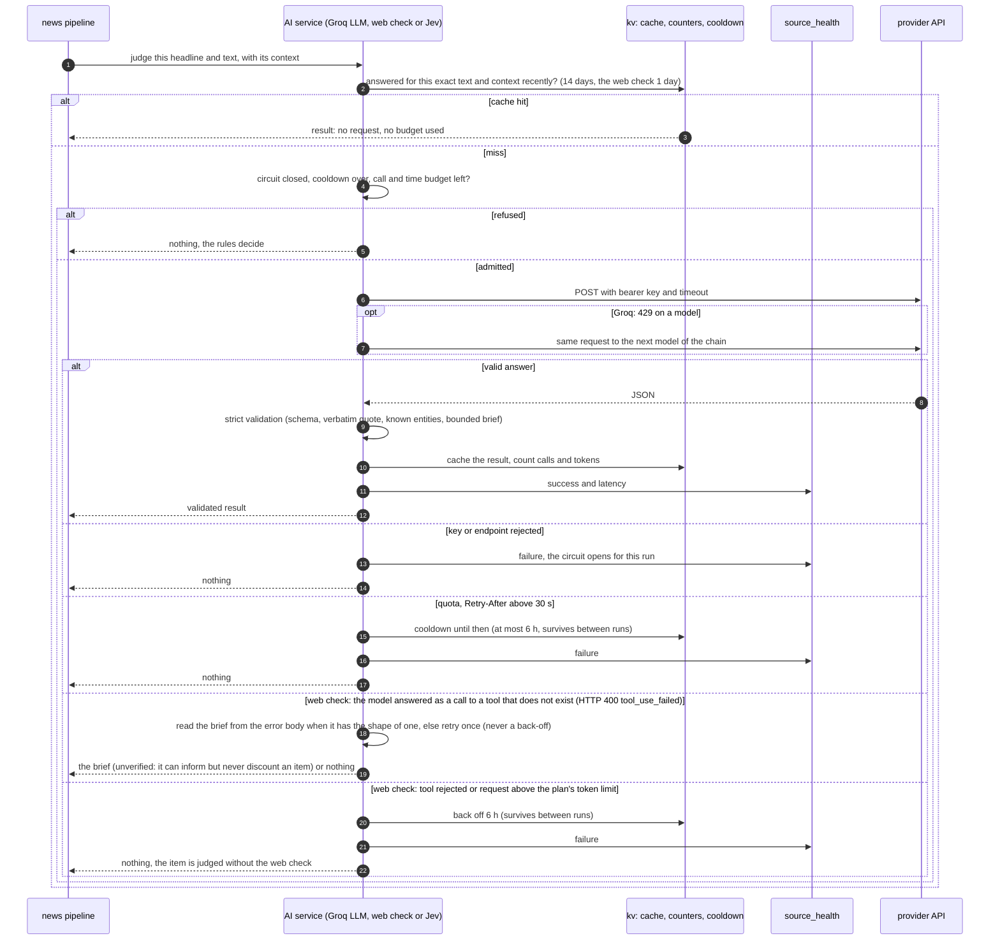

| | Groq LLM (`llm_extraction`) | Web check (`llm_web`) | Jev (`jev_judgment`) |
|---|---|---|---|
| Model | a chain: `openai/gpt-oss-120b`, then `openai/gpt-oss-20b`, then `qwen/qwen3.8-27b` (Groq's open-weight models: the largest for accuracy, the others as headroom because Groq's rate limits are per model, so every model adds its own allowance; `LLM_MODEL`, `LLM_FALLBACK_MODEL` and `LLM_FALLBACK_MODELS` set it). A rate-limited model cools down until its own limit resets and the best free model is used again as soon as it can be; a model that is gone or blocked for the account (404 / 403) is dropped for the run; Qwen runs in its plain mode and `<think>` blocks are stripped | the same chain, restricted to the models that offer the `browser_search` tool (the gpt-oss family only) | `jev-1.14.0`, pinned (the `jev-latest` alias moves without notice) |
| What it is | a text model: reads the article and returns structured JSON | Groq's built-in, server-side web search (powered by Exa) driven by a gpt-oss model. A request of its own, because Groq documents that browser search cannot be combined with structured outputs | a decision model: reads the article as a typed state and returns calibrated probabilities. It is not a price forecaster and not a chat model |
| Asked | event type, entities with a direction, severity, horizon, event time, a verbatim evidence quote | do independent outlets report the same facts, did anyone deny or correct them, was the event already public; up to three facts and the hosts relied on | event type (27-way choice), rumour, denial, severity (5 levels), direction for the company in focus |
| Trusted when | the evidence quote is found word for word in the text and every entity resolves to a known instrument; an unverified answer is capped at confidence 0.4 and cannot change the type, severity, horizon, time or any direction (it can only add companies the text really names) | every field is validated (allowed words, bounded integers, real booleans, link-free single-line facts, plausible host names); acted on alone only for a **sourced denial** (it names a reputable publisher of the source registry: an exchange, an official body, a wire or a business newspaper) whose facts are not confirmed | probability and confidence reach `JEV_MIN_CONFIDENCE` (0.5); a rumour or denial flag needs p >= 0.5 + `JEV_MIN_CONFIDENCE` / 2 |
| Never | invents evidence | raises a severity or a confidence, clears a flag, runs for an exchange filing, an official statement or a company's own release, for macro or sector news or a story about no listed company, or in a replay or backtest | clears a rumour flag the rules set, or flags an exchange filing or official statement as a rumour |
| Where it adds | news the rules cannot read: unusual wording, implied events, entities by description | the one thing the text cannot tell: is the rumour or the unverified deal true, denied or old | calibrated confidence on the event type, rumour and denial detection, a second opinion on severity and direction |
| Caps | per news job: `LLM_MAX_ARTICLES_PER_RUN` (60), `LLM_MAX_SECONDS_PER_RUN` (240 s), and a 14-day cache by text and context | per news job: `LLM_WEB_MAX_PER_RUN` (8) and per IST day `LLM_WEB_MAX_PER_DAY` (16), 30 % of the LLM time box, a 1-day cache; HTTP 413 or a rejected tool backs it off for 6 h | per news job: `JEV_MAX_ITEMS_PER_RUN` (200), 180 s, and a 14-day cache by text, context, company and source class |

Where both answer, the direction of the company in focus is the mean of the two readings when they agree and *unknown* (0) when they
point opposite ways; a direction offered for a rumour or a denial is halved, as the rules do. The company asked about is the one
the rules or the LLM already signed the event for (for an order, the winner and not the customer), else the most prominent one.

**What the services see** (`news_intelligence/context.py`): the headline, the whole stored text (up to 6 000 characters), and a
context block of the facts a human reader would use: when the item was published and when it is being checked (always in IST), the
source with its class (exchange filing, official statement, company, news media, social) and tier (wire, business media,
aggregator), the filing category, the issuer of a filing with its sector, the companies the entity matcher found in the text and,
when the web check ran, its brief. The LLM also gets the definition of every event type (the same definitions Jev's choice question
carries), so the rules, the LLM and Jev classify against one vocabulary. Never a key, a position, a prediction, a **price, a return or
the rules' own verdict**: the AI is meant to be an independent second reader whose answer is then compared with the rules', and a
price or a hindsight fact would let it explain a move instead of reading the news. Free text in the context (feed names, search
results) is single-line, length-capped and stripped of control characters and of the tags that structure the prompt.
The web check searches the public web; nothing of yours is sent with the request. Its time share is a hard bound: every request of
every service is given at most what is left of the run's wall-clock budget (and is not started when almost nothing is left), so a
slow provider cannot overrun it. The web check and the extraction share Groq's per-model token quota; when it is spent the
extraction hands over to the next model of its chain and the web check (which only has the gpt-oss models) backs off. A search is by far the most expensive call (about
7 000 tokens, measured: the pages it reads count as input tokens, charged to the per-minute and to the per-day limit, so about 28
of them use up a free-tier model's 200 000 tokens a day), hence a daily cap besides the per-job one (`LLM_WEB_MAX_PER_DAY`, counted per
IST day in `kv`): retries and manual runs cannot add up to a day of tokens that the extraction needs.

How it is observed: `monster-ai ai-test` sends one made-up item through the real code (and makes one real web search) and prints
what came back or why not; `monster-ai doctor` lists the models each key can use (no tokens spent); the counters `llm.*` /
`llmweb.*` / `jev.*` (calls, failures, tokens, cooldown) are in `kv` and in `monster-ai diag`; every service has a row in
`source_health`, so the health check warns after repeated failures; the report's coverage note names a degraded extraction or Jev;
every job's counts (used, cached, failed, skipped by budget, retyped, rumours, denials, web checks and refutations; summed over
the batches of a drained backlog) are in `news.last_run`, and what the web check found is kept in the event's evidence.

## The optional broker feed

`KOTAK_CONSUMER_KEY` (the application token of a Kotak Neo account) adds a second real-time source beside NSE and exchange-grade intraday candles.
It is **read-only**: Kotak's quotes, history and instrument-master endpoints answer to the token alone, so nothing here logs in, holds a
session, knows the MPIN or places an order (the system never trades; the trading credentials are not even settings). If a local `.env` carries
them anyway (`KOTAK_MOBILE`, `KOTAK_UCC`, `KOTAK_MPIN`, `KOTAK_TOTP_SECRET`), the loader ignores them and the deploy scripts upload only the
settings `.env.example` defines (`deployment/lib/envseed.ps1` and `envseed.sh`), so they never reach the server.

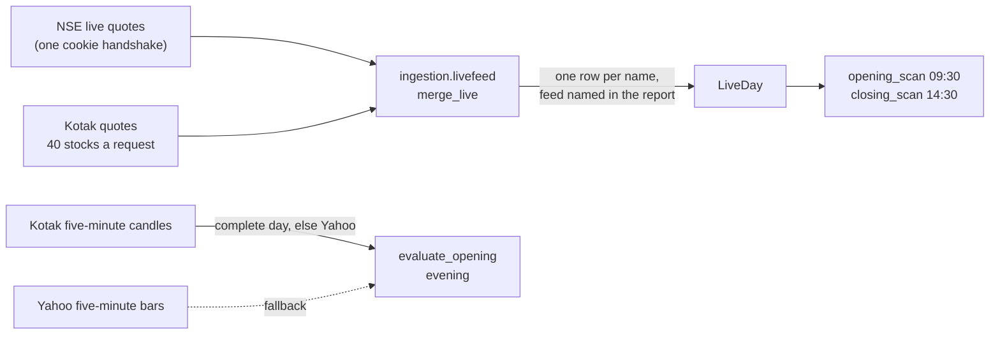

**Live quotes** (`ingestion.kotak.KotakApi`, `ingestion.pipeline.collect_kotak_quotes`, `automation.ideas.fetch_live`). The instrument master (symbol to
token, about 3 MB) is read once a day into the database (`kotak:tokens`); quotes go out 40 stocks to a request (the documented 50 is refused with
HTTP 400, 49 works) over a plain `requests` session that keeps the connection alive (curl_cffi's streamed responses close it, which costs this host's
2 s handshake on every call). A refused batch is halved until the one stock the API cannot quote is found. Each row carries the stock's own last-update
time, so the age of the FEED (the freshest trade of ~200 liquid stocks) is measured on every answer. `ingestion.livefeed.merge_live` then decides, per name:

- a name only one feed has comes from that feed; with NSE down the broker alone carries the scan, with the broker down (or not configured) NSE alone
  does, exactly as before the broker existed;
- a name both feeds have must **agree**: the previous close within 0.3 %, the open within 0.5 % (when both have one) and the last price within
  3 %. Those do not move between two snapshots seconds apart, so a bigger gap is a data fault (a corporate action applied by one feed only, a wrong
  instrument): which side is right cannot be told, so the name is left out of that scan and named in the report's notes;
- of two agreeing rows the **fresher** is taken whole, never a mix of fields: the day's volume only ever grows, so the row with the larger volume
  has seen more trades; a tie goes to NSE, the feed the model was validated on;
- during the session a broker feed whose freshest trade is older than `KOTAK_MAX_LAG_SEC` is not used at all; outside the session no age is judged
  (an evening preview reads the day's final figures);
- Nifty 50 and India VIX are asked of the broker only when NSE's index call gave nothing.

The report's `source` line names the feeds (`NSE (...) + Kotak broker feed: N of M names ...; K confirmed by both`, or `Kotak broker feed (NSE did
not answer)`), and a note says so when the broker was unavailable, lagging or in conflict with NSE.

**Candles** (`automation.opening._intraday`). `evaluate_opening` asks the broker for the five-minute candles of each listed name's day, inside the
same 120-second budget as Yahoo, and judges a day only when all 72 five-minute bars from 09:15 to 15:10 are there (a missing stretch is never judged
as a quiet one; the day is cut to those bars, so a flat artefact bar after 15:10 is ignored) and otherwise asks Yahoo for that name instead. The
broker's session normally ends with the 15:10 bar (the last 15 minutes are missing), and on some days (found on 2026-10-14, 10-28, 10-29 and
11-05) the archive marks the 15:10 bar with a negative volume, which the parser drops: such a day is unfinished and falls back to Yahoo, which
only affects the plan judging of the few listed names, because every name the model scored is judged on the official daily bars. Why not Yahoo's: measured on the same stock-days, Yahoo's five-minute bars are
smoothed (its first-15-minute range is about a tenth narrower than the exchange's, and its 09:15 bar misses the opening spike and the auction's
volume), where the broker's candles are the exact aggregate of its one-minute candles and reproduced NSE's official day low for 60 of 60 stocks.
The same measurement is why the opening model's coefficients were refitted on the broker's candles (see [The 09:30 opening read](#the-0930-opening-read)).

**Rails.** One client per endpoint family (`kotak_quotes`, `kotak_history`) with the shared spacing, bounded retries, circuit breaker and deadlines,
recorded in `source_health`; the token is a request header, never in a URL or a log (it is registered for redaction like every secret), is sent only
to https hosts on `kotaksecurities.com` (`KOTAK_BASE_URL` is refused at start-up otherwise, and a file URL the API returns is followed only on such a
host, without the token). Tests never reach the network: the broker is a scripted double in every scan test.

## Packages

| Package | Responsibility |
|---------|----------------|
| [app/](../app) | configuration (single typed catalogue in `config.py`, generates `.env.example`), injectable clock (UTC instants, IST market logic, display zone), logging (daily files, secret redaction, crash hooks) with the `logs` / `diag` tools, code fingerprint (`release.py`), file locks, resource guards (RSS watchdog, disk, RAM), CLI, `doctor` (machine preflight) and `sourcecheck.py` (reads every data endpoint through the production clients: `monster-ai sources-check`), error hierarchy |
| [ingestion/](../ingestion) | the curl_cffi HTTP transport (`http.py`: browser impersonation, adaptive per-source rate limit, retries, circuit breaker, deadlines), Yahoo (chart + bulk `spark` probe), NSE archive and API clients, validation, universe building, freshness / data-quality gate, split-adjusted reads (`adjust.py`) and basis-break repair (`basis.py`), news collectors (RSS conditional GET), source catalogue (`registry.py` -> [DATA_SOURCES.md](DATA_SOURCES.md)) |
| [database/](../database) | SQLite connection (WAL, busy timeout), versioned migrations, the `Store` repository, verified online backups with a size budget (optionally gpg-encrypted), S3-compatible object store (SigV4, stdlib only), off-box backup helpers |
| [features/](../features) | the single feature builder used by training and live scoring: technical, F&O, global, regime, calendar, sector, similar-day; label construction; schema hash and `FEATURE_VERSION`; the point-in-time panel loader; `swing.py`, the as-of-session features of the closing-hour trade ideas (volume projected to a full day) |
| [news_intelligence/](../news_intelligence), [event_graph/](../event_graph) | deduplication, entity linking, event extraction (rules first, then the optional Groq LLM `llm.py`, its web check `web.py` and Jev `jev.py` behind the shared safety rails of `remote.py`; `context.py` holds the facts both readers receive; `ai_check.py` is the live self-check behind `ai-test`), source quality and provenance (rumour, source class, independent sources), "priced in" detection; supply-chain / sector impact propagation over a seeded expert-prior graph whose edges are re-measured weekly from returns ([automation/graph_learning.py](../automation/graph_learning.py): lagged regression, out-of-sample lag choice, sign stability, Benjamini-Hochberg control; edges without a price series stay labelled priors) with an append-only edge history |
| [models/](../models) | LightGBM specialists + meta model, isotonic calibration, walk-forward training, gates, artifact format (text models + JSON, **never pickle**), registry (champion/challenger, rollback), HMAC-signed bundles for external training |
| [ranking/](../ranking) | eligibility, conviction tiers, contradiction checks, cost estimates (intraday and delivery-style), abstention, baselines; `ideas.py`, the closing-hour trade ideas: setups, gates, mechanical ATR levels, news veto, market regime; `opening.py`, the 09:30 opening model: history stats, the opening-range table, logistic and log-linear estimates with their evidence, strength bands, reference levels |
| [notifications/](../notifications) | Telegram client (messages and photos), report renderers (4096-char safe; `style.py` holds the emoji, bars and next-step hints, `samples.py` the made-up data behind `telegram-preview`, `ideas.py` the closing-hour report, `opening.py` the 09:30 report), chart images (`canvas.py` drawing primitives, `charts.py` the four charts), idempotent delivery with a ledger and deadline guard |
| [automation/](../automation) | the scan, the closing-hour ideas scan and evaluation (`ideas.py`), the 09:30 opening read and its evaluation (`opening.py`), all jobs, the schedule engine, the daemon, the job runner, bootstrap, health, the exchange calendar, bounded-storage retention |
| [backtesting/](../backtesting) | outcome evaluation (provisional -> official), metrics with day-block bootstrap intervals, the live range-forecast record and its slices, walk-forward backtest; `ideas.py`, the outcome rules and the live-record gate of the trade ideas; `opening.py`, the outcome rules, the intraday plan judging and the model's live record for the 09:30 read |
| [dashboard/](../dashboard) | optional read-only FastAPI dashboard (loopback by default) |
| [deployment/](../deployment) | installer, systemd units, remote deploy scripts - see [deployment/README.md](../deployment/README.md) |
| [scripts/](../scripts) | `generate_docs.py`: regenerates `.env.example` and `docs/DATA_SOURCES.md` from the code (tests fail when they drift) |

## Point-in-time correctness

A scan at time *T* may use only what was knowable at *T*.

- Price, volume and F&O features are **shifted by one session** (a morning scan never sees today's bar).
- Global series are used at each series' own availability: a US close is known in the morning, a live quote is
  taken at the scan cutoff, and a stale series is blanked (after 4 days; 7 for European and Asian equity series) instead
  of being forward-filled silently.
- Calendar and results-calendar features are known in advance and are not shifted.
- Stage `final` adds `p_*` gap features computed from the pre-open price only; names without a pre-open price fall
  back to the `pre` model (reported as such). Pre-open rows are stored only when stamped on the trade date (IST): outside
  the pre-open session NSE serves the *previous* session's book, and that must never become today's opening gap.
- **One price basis.** Official end-of-day rows are stored raw and re-based on the post-split basis when they are read
  (`ingestion.adjust.adjusted_bars`, used by features, graph learning and the news reaction check), so the order in which
  rows and split events arrive never matters. A split of a stock that already has history is detected from the exchange's
  own previous close (`ingestion.basis`): the vendor is asked for exactly that stock until it reports the split, and the
  operator is told after six sessions. On the ex-date morning the pre-open book exposes the break before the vendor does,
  and such a name is scored **without** its (meaningless) opening gap.
- **Point-in-time membership and survivorship.** F&O membership is a point-in-time flag; a training panel also holds the
  quarantined, suspended or delisted names that have bars in the window. Names the database never ingested stay unknown
  (documented limitation).
- Relative-volume baselines exclude the current session; similar-day features use the same fixed pool and window in
  training and live, so a live row equals the batch row for the same day.
- News and event features are computed from `first_seen_at` (when the system saw an item), never from later edits;
  event-graph edges keep an append-only history so replays can use the edges as they were (opt-in).
- Muhurat and other special sessions are removed from the training panel (market-wide volume far below the
  trailing median) and never count as a "missing" session.
- `tests/test_features_leakage.py` guards this: future data cannot change past features, the current session's path
  never reaches the `pre` features, the `final` stage sees only the session open, global series follow availability,
  and a live row equals the batch row for the same day (train/serve parity). Walk-forward folds are separated by an
  embargo.

Snapshots (features, predictions, data quality, model and code version) are **immutable**: one is written per
(date, stage) in the normal flow, the snapshot and its predictions are committed in **one transaction**, a retry
re-sends the frozen report (restoring the predictions if an old interrupted freeze lost them), and an operator's forced
re-scan adds a new snapshot without ever editing an old one. Evaluation scores only the *effective* (latest) snapshot of
a (date, stage), and a day is scored on its final snapshot, else its preliminary one, so a forced re-scan is never counted
twice. The stored features carry a hash that can be re-verified, the inputs the scan saw (latest source timestamps, arrival
times, counts) are recorded, and `code_version` is `<release>+<fingerprint of the code>`: any frozen report can be traced to
the exact code that produced it (`monster-ai version` prints the running value).

## Models and governance

- **Specialists** (`models/specialists.py`): technical, F&O, global, regime, events, direction. Each is a small
  LightGBM model per target (range thresholds 1/2/3/5 %, "unusual" = range above 1.5x the trailing mean, up/down).
- **Meta model** on out-of-fold specialist outputs plus context; **isotonic calibration** per head; quantile heads
  for the expected range (q10/q50/q90).
- **Walk-forward training** with an embargo, 8 folds, a held-out final block; ranking edge is measured against
  simple baselines (20-day range, ATR, yesterday's range, volume, opening gap, random) with a day-block bootstrap.
- **Gates** (fixed in config, not tuned per run): enough held-out days, ECE <= 0.06, positive Brier skill vs climatology
  and a one-sided 90 % edge over the best baseline. Status is `validated`, `shadow` (calibrated and skilful, edge not
  demonstrated: still useful for research), `rejected` (never activated) or `baseline` (no trained model, heuristic only).
- **Registry**: every version is stored with metrics, gate outcome, feature-schema hash, the code fingerprint and a manifest
  checksum recorded at registration. A challenger replaces the champion only if it matches or beats it on the same gate
  metrics; a corrupt, stale or wrong-feature-version champion is replaced or rolled back automatically, falling back to the
  heuristic baseline if nothing verifies. Daily outcomes never edit a model. A change of `FEATURE_VERSION` (now `fv2`)
  retires the older models: scans use the labelled baseline until the next `train` has produced a model.

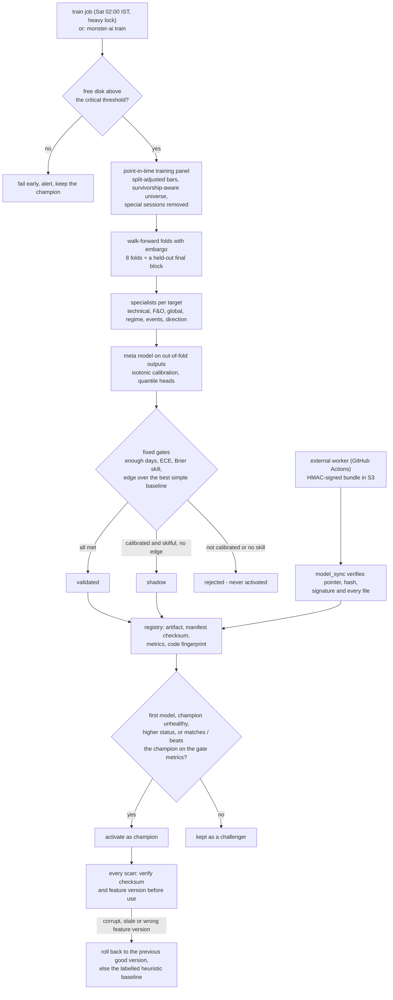

## Honesty rules

- Probabilities come from calibrated models. The heuristic baseline is always labelled "(heuristic, NOT calibrated)".
- Conviction tiers (STRONG >= 55 %, MODERATE >= 40 %, WATCH >= 25 % calibrated P, each with an uncertainty ceiling) are capped
  at **WATCH unless the model is `validated`**.
- The uncertainty ceilings are **relative, not absolute**. Uncertainty (0 reliable .. 1 unreliable; not a probability) rises with
  the probability itself, because the names most likely to have a large range are the volatile ones with the widest
  intervals and the most specialist disagreement; a fixed ceiling therefore made STRONG unreachable on real data, and one
  pooled ceiling would abstain on every hot day. At training time the model records how uncertain its own held-out daily
  top-15 names were at each calibrated-probability level (`unc_scales.pick_curve`: median and 85th percentile). A live pick is
  judged against names of **similar probability**: STRONG needs uncertainty at or below their median, MODERATE at or below
  their 85th percentile. A pick (or a whole day) that is unusually unreliable for its level therefore still abstains. Models
  without a curve (older artifacts, the heuristic baseline) use `MAX_UNCERTAINTY_STRONG` / `MAX_UNCERTAINTY_MODERATE`. The
  ranking itself is unaffected: it stays by probability.
- When nothing qualifies the report says **"no setup"** and why; it never pads the list. The reason names the actual cause
  (low probability, uncertainty above the model's usual range for its picks, conflicting evidence) with counts.
- A report that would be delivered after the 09:14:30 deadline is withheld (the alert is queued and sent later).
- Ranking uses the calibrated range probability only. The report states that a wide range does not imply a profitable
  trade or a directional close; the direction head is a diagnostic and is near chance in out-of-sample tests.
- Every statistic in the evening report carries its sample size and a 95 % interval (day-block bootstrap, because the picks
  of one day are dependent); below five days it prints "n/a" instead of a number it cannot support. News catalysts show how far
  they can be trusted (rumour, source class, independent sources, conflicts).
- The AI services are advisers, never authorities: the rules always run, an AI answer only adds information (an LLM claim
  needs a quote that appears word for word in the text; Jev must be confident and may not clear a rumour flag or flag an
  official filing; the web check can only discount a story it found denied, never raise anything), a failure falls back to the
  rules, and the report says when a service was degraded. They change which catalysts are shown and how they are labelled,
  **not** the calibrated forecast.

## Scheduling and self-healing

- **Ledger-based scheduler** (`automation/scheduler.py`): one child process at a time (`python -m app.cli run-job`), so
  a leak or crash is contained; sd_notify watchdog; timeouts; preemption of non-critical jobs by critical ones.
- **Idempotent jobs**: locks per job and a shared heavy lock; run keys (`2026-11-02`, `2026-W44`); retries with
  back-off; catch-up for after-close jobs; windows that closed before the first start are skipped silently, and so are the
  windows that closed before an entry existed: the engine records when it first saw each timetable entry
  (`daemon.entries_seen`), so a job added by an upgrade is never reported as missed for the days before the upgrade (the first
  release that records this stamps every entry with the first start).
- **Bootstrap** is a resumable 12-step state machine (`bootstrap.state` in the `kv` table). A crash, reboot or
  out-of-memory kill resumes where it stopped; repeated crashes in an optional step skip that step instead of looping.
- **Watchdogs**: per-job RSS ceiling (`JOB_MAX_RSS_MB`), systemd `MemoryHigh/MemoryMax`, service watchdog, a health
  timer that alerts independently of the daemon, a heartbeat that is written to a file as well as to the database (so a
  locked database is distinguishable from a dead daemon), and a self-reported alert when the daemon finds that its previous
  run ended uncleanly.
- **Resource gates**: heavy jobs are deferred while free disk is below the critical threshold or RAM is low, and the light jobs
  behind them still run; training checks the disk before it starts.
- **Health** (`automation/health.py`): data freshness, missing sessions, model age and status, source failures,
  backup age, disk and RAM, storage budget and retention, calendar coverage, delivery failures, performance drift. Alerts are
  de-duplicated and queued until Telegram works again.

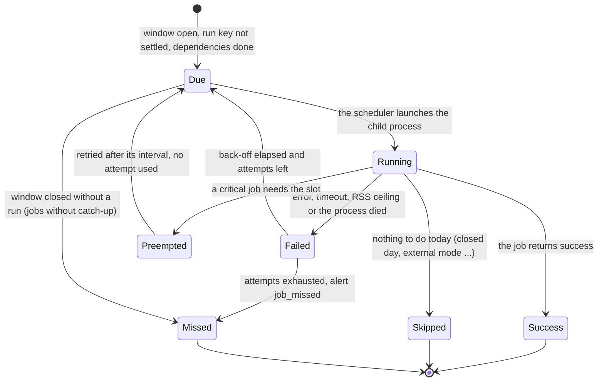

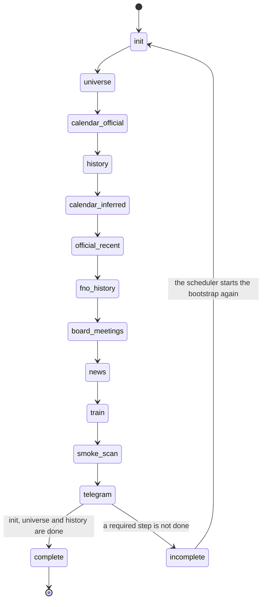

Each bootstrap step records its own status in `bootstrap.steps`; `init`, `universe` and `history` are required, the rest
can fail or be skipped without blocking the timetable (they are retried by the regular jobs).

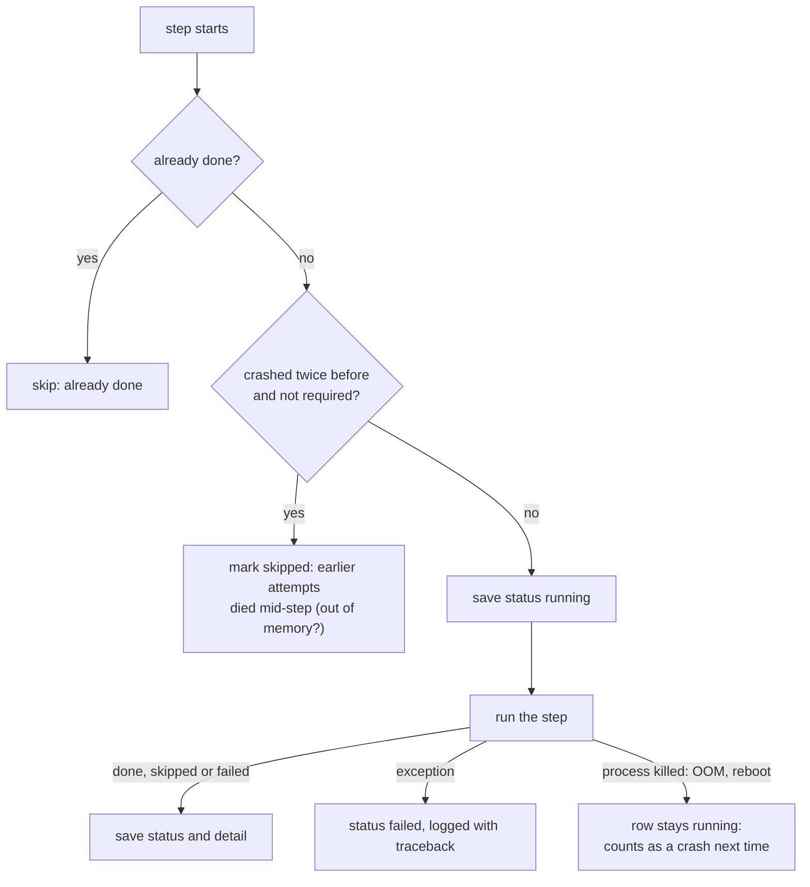

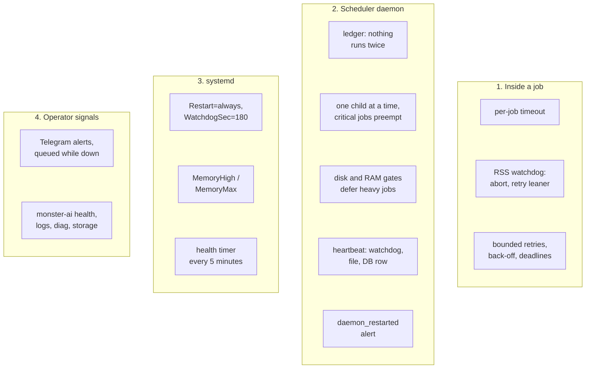

## Network layer: curl_cffi, bulk fetching, rate limits

Every call to a scraped or public data source goes through one client, `ingestion.http.HttpClient` (built by
`HttpClient.from_settings(source, settings)`). Its job is to be a polite, resilient, browser-like client that cannot burn the
09:12 cutoff:

- **Transport: curl_cffi.** libcurl with a real browser TLS / HTTP-2 fingerprint (`HTTP_IMPERSONATE`, default `chrome`), so the
  CDNs and bot managers in front of NSE and Yahoo treat the server like an ordinary browser. If curl_cffi cannot be imported
  or rejects the profile, the client degrades to `requests` (first without the impersonation profile, then without
  curl_cffi) and logs it once. While impersonating, the browser's own `User-Agent` / `Accept-Encoding` headers are never
  overridden (a mismatch with the TLS fingerprint is an easy bot signal). `HTTP_TRANSPORT` can force a transport.
- **Politeness.** A per-source rate limiter spaces requests (`YAHOO_MIN_INTERVAL_SEC`, `NSE_MIN_INTERVAL_SEC`, 0.4 s per RSS
  feed, 6 s for GDELT) with 20 % jitter; a 429 or `Retry-After` doubles that source's spacing (up to a cap) and every success
  eases it back. A circuit breaker fails fast after 6 consecutive failures and half-opens after 5 minutes.
- **Retries.** Statuses 408, 425, 429, 500, 502, 503 and 504 retry with exponential back-off and jitter (or `Retry-After`,
  capped at 60 s), at most `HTTP_MAX_ATTEMPTS`; no attempt starts after the caller's **deadline**, and each attempt's timeout is
  capped to the time left, so the pre-open polls can never push a report past its cutoff.
- **Safety.** HTTPS only; a hard response-size cap (`HTTP_MAX_RESPONSE_MB`, a RAM guard); errors and logs carry host and path
  only, never the query string (it may hold a key); NSE's cookie handshake is re-done automatically on 401/403.
- **Traceability.** One DEBUG line per request, WARNING lines for retries and give-ups, and per-source counters (requests,
  failures, 429s, bytes) that the job runner logs as a `network:` line at the end of every job.

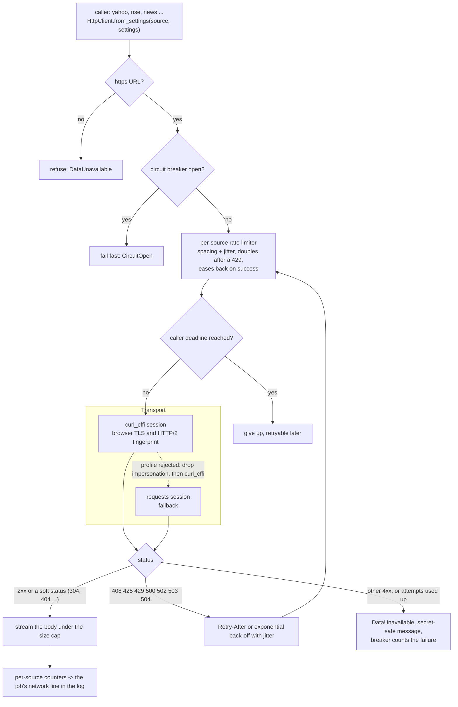

**Bulk fetching and batching** keep the request count (and so the rate-limit exposure) low:

| Data | Strategy |
|------|----------|
| Equity end-of-day bars | the **official NSE file** (one request per day, every stock, official OHLC / VWAP / delivery); Yahoo is only the repair path for names the file lacks and for the first history backfill |
| Global series (~33 indices, FX, commodities, rates, VIX) | one Yahoo `spark` probe answers **20 symbols per request**; series whose newest stored bar already equals the vendor's are skipped (two requests instead of ~33); the probe can only skip a fetch, any doubt falls through to the normal fetch, and every series is fetched in full at least every 24 h |
| History backfill | resumable per instrument (`yahoo_history:*` progress), deadline-bounded chunks, one full download per symbol |
| F&O | one UDiFF zip per day (all contracts), parsed once |
| RSS feeds | **conditional GET** (`ETag` / `Last-Modified`): an unchanged feed costs one tiny 304; one unconditional fetch every 6 h; a feed that fails 6 times is parked for 24 h |
| NSE API | one pre-open call returns the whole book; GIFT Nifty comes from the market-status call already needed for the session state |
| GDELT, then Google News search | GDELT: minimum spacing 6 s, one query per topic (eight a run), given up after two failed queries in a row; Google News search: one query per topic GDELT did not deliver, through the RSS client (0.4 s spacing) |

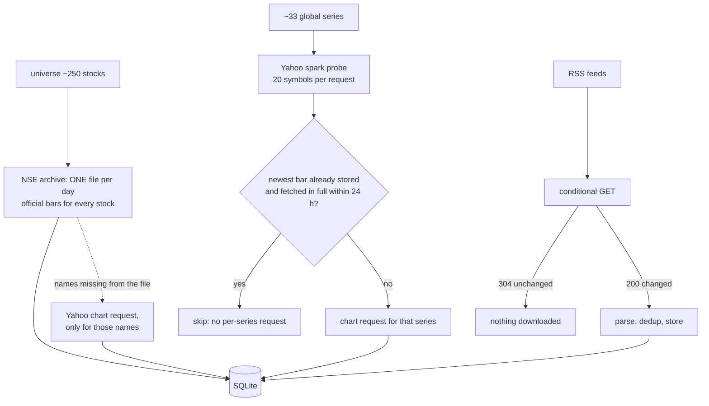

## Exchange calendar for any month and year

The calendar (`automation/calendar.py`) never needs a code change when a year turns over, and works with or without
network access:

1. weekends are always closed;
2. the shipped seed (`data/seeds/nse_holidays.json`) and NSE's live holiday API (refreshed daily at 05:30 IST) are the **official**
   lists; a year counts as officially covered once it has at least 8 entries (NSE lists 14-20 trading holidays a year);
3. for a year without an official list (NSE publishes the next year's in December) a **rule layer** applies the holidays that
   can be derived with certainty - the fixed-date national holidays (26 Jan, 14 Apr, 1 May, 15 Aug, 2 Oct, 25 Dec) when they fall
   on a weekday, and Good Friday from the Gregorian Easter algorithm - flagged `source='rule'`. Lunar-calendar holidays
   (Holi, Diwali, Eid ...) cannot be derived and are deliberately **not guessed**;
4. the **live confirmation**: before a final report goes out in such a year, NSE itself is asked. If it answers but
   publishes no pre-open book after 09:06 IST, the day is recorded as an inferred closure, no report is sent and the
   operator gets a `holiday_inferred` alert. An unreachable NSE proves nothing, so the scan simply goes on;
5. days on which the Nifty index has no bar are inferred as closed retroactively, and an **operator override file**
   (`data/seeds/special_sessions.json`, or `calendar_overrides.json` in the data directory, which survives upgrades) can
   re-open a day (Muhurat and other special sessions) or close one at short notice.

Rule rows disappear the moment the official list arrives; official rows are never overwritten by rules, and a holiday NSE
later removes from a future date is dropped. Health warns 21 days before the official list ends (`calendar_horizon`), after it
lapsed (`calendar_unofficial`) and when the refresh keeps failing (`calendar_stale`, `calendar_never_refreshed`); the report
itself says "holidays are rule-based" while it relies on the rule layer.

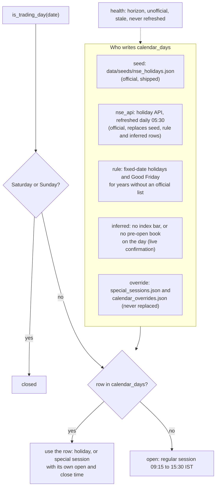

## Time zones

A server in any time zone produces the same results. The rules, enforced by tests:

- **Storage is UTC.** Every stored instant is an ISO-8601 UTC string (`...Z`); the clock hands out timezone-aware instants only.
- **Market logic is IST, explicitly.** Session dates, schedule windows, scan cutoffs and deadlines are computed with
  `ist_date`, `at_ist` and friends from `app/clock.py` using `Asia/Kolkata` (a fixed +05:30 offset is the fallback if the
  tz database is missing). India has no daylight saving, so nothing shifts twice a year.
- **The process zone is pinned to UTC** at start-up (`pin_process_timezone` in `cli.main()`), so even a stray `localtime()`
  cannot differ between servers; no systemd timer depends on the system zone (the scheduler is ledger-based, the health timer
  is monotonic).
- **Display only:** `MONSTER_TIMEZONE` (default `Asia/Kolkata`) sets the zone of log stamps (`2026-11-02T08:30:05.000+0530`)
  and nothing else.
- **Guards:** an AST test fails the build on any API that silently reads the server's zone (naive `datetime.now()`, `utcnow()`,
  `date.today()`, `time.localtime()`, `.astimezone()` without an argument, SQLite `'now'` / `'localtime'`; two documented
  exceptions), and a matrix test computes exchange dates, session windows, the job timetable, holidays, retention cut-offs and log
  stamps in fresh interpreters whose process zone is UTC, US Pacific (DST), India, New Zealand (DST) and UTC+14, requiring
  identical results equal to values worked out by hand.

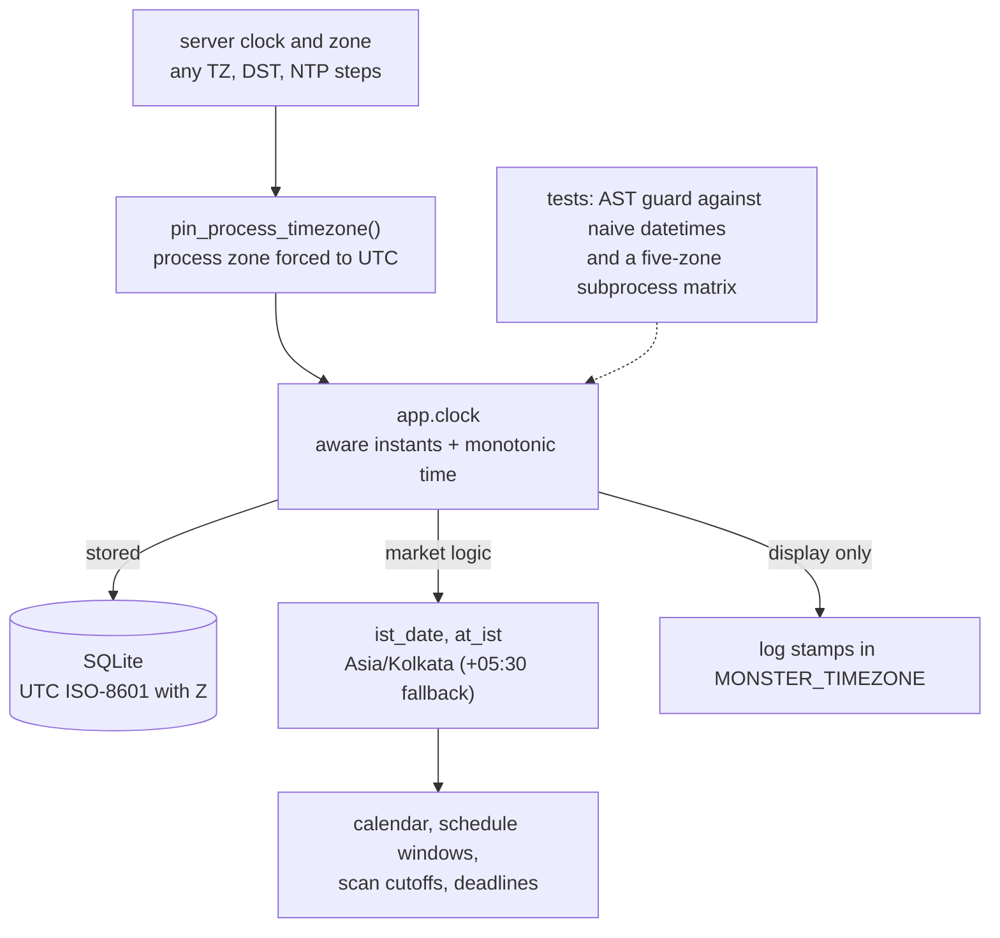

## Storage and bounded retention

Nothing may grow forever. The nightly `housekeeping` job (23:50 IST) applies `automation/retention.py`, in small
foreign-key-safe transactions that never starve the scheduler's heartbeat of the single SQLite writer:

| What | Rule (default) | Setting |
|------|----------------|---------|
| raw news and filing text | deleted after 45 days, structured events kept | `NEWS_RETENTION_DAYS` |
| structured events | 1100 days after their last update | `EVENT_RETENTION_DAYS` |
| pre-open and live quotes | 400 days; every pre-open poll is kept 14 days, then only the last one per symbol and day | `QUOTE_RETENTION_DAYS` |
| daily bars, F&O rows | `HISTORY_YEARS` + 1 years (the oldest data ever read) | `HISTORY_YEARS` |
| snapshots, predictions, outcomes, metrics, graph edge history | 1825 days (immutable: pruned explicitly, children before parents) | `RECORD_RETENTION_DAYS` |
| trade-idea reports and their outcomes (`ideas:run:`, `ideas:out:` in `kv`) | 1825 days after their last update | `RECORD_RETENTION_DAYS` |
| job runs, deliveries, alerts | 180 days (delivered alerts: half) | `OPS_RETENTION_DAYS` |
| backups | 7 daily + 4 weekly **and** a total size budget | `BACKUP_KEEP_*`, `BACKUP_MAX_MB` |
| logs | 30 days within a 150 MB budget; today's files are never removed | `LOG_RETENTION_DAYS`, `LOG_MAX_MB` |
| cache, temp, quarantined restores, diagnostic bundles | 200 MB / 14 days, 1 day, 14 days, newest 5 | constants |
| the whole data directory | 4000 MB budget; above it the optional data is trimmed harder | `DATA_MAX_MB` |

Under **disk pressure** the optional windows shrink to half (free disk below the warning threshold) or a quarter (below the
critical threshold), never below a week; the immutable records and the price history are shortened only by their own window.
`VACUUM` runs only when it is due (Sundays, pressure, or forced), worthwhile (at least 32 MB or 15 % free pages) and the disk has
about three times the database size free. The result of every run is stored (`retention.last`), `monster-ai storage` shows the
usage and `--prune [--dry-run] [--vacuum]` applies it on demand, and health warns at 80 % of the budget, when the WAL file
exceeds 256 MB, or when the retention has not run for three days.

```mermaid
flowchart TB
    HK["housekeeping job, 23:50 IST daily"] --> RET["run_retention"]
    RET --> PR["disk pressure from free space<br/>ok x1, warn x0.5, critical x0.25<br/>(over the data budget: x0.5)"]
    PR --> TB["table policies, children first<br/>outcomes, predictions, snapshots, quotes, news events,<br/>alerts, deliveries, job runs, metrics, F&O, bars,<br/>graph edge history"]
    PR --> KV["kv rules: evaluation summaries,<br/>trade-idea records, fetch markers,<br/>a stale prune flag"]
    PR --> FS["file sweeps: cache, tmp, backup leftovers,<br/>quarantine, diagnostic bundles, logs"]
    PR --> BK["backups: 7 daily + 4 weekly<br/>within the total size budget"]
    TB --> DBM["maintain_database<br/>WAL checkpoint, PRAGMA optimize,<br/>VACUUM when due, worthwhile and safe"]
    KV --> DBM
    DBM --> REP["retention.last in kv<br/>monster-ai storage report"]
    FS --> REP
    BK --> REP
    REP --> HLT["health: storage budget, WAL size,<br/>retention stale or erroring -> Telegram alert"]
```

## Logging and diagnostics

Every process (daemon, each job child, CLI commands, the dashboard) logs through `app/logging_setup.py`:

- **Daily files, never renamed.** `logs/<role>-YYYY-MM-DD.log` (roles: `daemon`, `jobs`, `cli`, `health`, `train`, `bootstrap`,
  `dashboard`), at most 25 MB x 4 files per day with a drop-count marker, mode 0640. A shared `errors-YYYY-MM-DD.log` collects
  WARNING and above of **all** processes with their role and pid, so one file answers "what went wrong today". Concurrent
  processes can append safely (no rotation renames), and logrotate is deliberately restricted to redirected `.out` files and the install log.
- **Traceable.** Stamps carry milliseconds and the offset; each job line carries its tag `[<job> <run key>#<attempt> r<run id>]`; the
  job runner logs start, duration, peak memory and a per-source `network:` line; the daemon logs every finished job with its
  duration; unexpected exceptions are logged with tracebacks (token-bearing paths log only the place, `exception_site`).
- **Crashes are captured:** `sys.excepthook`, thread and unraisable hooks, and `faulthandler` (native crashes) write to the log
  and to `fault-<role>.log`; warnings from libraries are captured too.
- **Secrets are redacted** in the formatter, so no handler can leak them; `LOG_FORMAT=json` switches to one JSON object per line.
- **Operator tools:** `monster-ai logs [--role R] [--date D] [-n N] [--level L] [--job J] [--grep T] [--since 90m] [--follow]
  [--list]` reads, filters (with multi-line tracebacks kept together) and follows the files in bounded memory;
  `monster-ai diag` writes a redacted `diag-<UTC>.tar.gz` (versions, offline doctor, settings, health, storage, database summary,
  log tails) to attach to a bug report.

```mermaid
flowchart TB
    subgraph PROCS["Every process"]
        D["daemon"]
        J["job children"]
        C["CLI commands"]
        W["dashboard"]
    end
    PROCS --> LG["logging_setup: redaction, job context,<br/>display-zone stamps"]
    LG --> F1["logs/ROLE-YYYY-MM-DD.log<br/>25 MB x 4 files per day"]
    LG --> F2["logs/errors-YYYY-MM-DD.log<br/>WARNING and above, all roles"]
    LG --> JD["stderr to journald"]
    CR["crash hooks: excepthook, threads,<br/>unraisable, faulthandler"] --> F1
    CR --> FL["logs/fault-ROLE.log"]
    F1 --> LV["monster-ai logs:<br/>level, job, text, time, follow"]
    F2 --> LV
    F1 --> DG["monster-ai diag:<br/>redacted bundle"]
    F2 --> DG
    HKJ["housekeeping: prune_logs<br/>30 days and 150 MB"] -.-> F1
```

## Degradation matrix

| Failure | Behaviour |
|---------|-----------|
| NSE API blocked / pre-open empty | final scan uses the `pre` model for names without a pre-open price and says so; if the book never arrives the report is still sent, marked |
| NSE live quotes blocked, not from today, or too few complete rows (14:30 scan) | the closing-hour scan **fails visibly** (`ideas_scan_failed`, a notice on the last attempt), retries every minute until 15:00 and sends no ideas: nothing is guessed from older prices. With the Kotak feed on, the broker alone carries the scan instead and the report says so |
| NSE live quotes blocked, not from today, or too few complete rows (09:30 scan) | the opening read **fails visibly** (`opening_scan_failed`, a notice on the last attempt), retries every 20 seconds until 09:44 and sends no report: nothing is guessed from older prices. With the Kotak feed on, the broker alone carries the scan instead and the report says so |
| the Kotak feed is down, refuses the token, lags (the freshest trade older than `KOTAK_MAX_LAG_SEC` during the session) or is not configured | NSE alone answers, exactly as without a broker; a note in the report says why the broker was not used (never for "not configured") |
| NSE and Kotak disagree on a name (previous close 0.3 %, open 0.5 %, last 3 %) | that name is left out of the scan and named in the report's notes; the others are unaffected |
| both feeds fail | the scan fails visibly as above, naming both reasons (`NSE and Kotak live quotes unavailable (...)`) |
| the quotes are stamped before the third candle closed, or more than 30 minutes after the open | before: the scan fails and retries (the range is not formed yet); after: it is no opening read and does not run. A retry a few minutes late is normalised to the fifteen-minute basis and the report says so |
| no 09:12 snapshot was frozen for the day | the opening read goes out with the new movers only and says so; the silent 08:45 snapshot stands in when it exists, a final scan with no candidates means no picks |
| news store or feeds degraded at 09:30 | the movers are listed without news and the notes say so; the read is never held back for news |
| Yahoo's five-minute feed unavailable in the evening | the opening reads are judged on the daily bars only (the range ahead and the levels as a plan are left out for that night and judged on a later one while the feed still reaches back). With the Kotak feed on, the broker's candles judge them first and Yahoo only fills in the names the broker has no complete day for |
| NSE renames its live-quote endpoint again | the client tries the known names, moves on only on a 404 and names them in the error; until the code is updated the scan fails visibly as above |
| Stored history incomplete before the closing scan | the scan stops and says which session is missing (`run collect_india`); a special session such as Muhurat trading is tolerated |
| Closing-hour report ready after 15:05 | frozen and withheld (`ideas_deadline_missed`); `ideas --force` sends the frozen report marked late, and a report built after the deadline never counts toward the live record |
| Nifty or VIX quotes missing at 14:30 | the scan goes on without them and the report's notes say that Nifty and VIX are not shown and relative strength to Nifty is not used |
| Yahoo down or rate limited | official bhavcopy first; global block is withheld only when >= 6 critical series are stale, otherwise degraded with warnings; the client slows that source down and a circuit breaker stops hammering it |
| curl_cffi unusable (missing wheel, rejected profile) | automatic fallback to `requests`, logged once; some providers may then block the client |
| Previous session incomplete | repair from the official file; if coverage stays low the data-quality gate **blocks** the scan, alerts and (on the last attempt of the final scan) tells you why |
| Vendor bars still provisional | the official file replaces them in the morning job and again, for the last three sessions, in the nightly housekeeping |
| Split / bonus with an ex-date today | the name is scored without its meaningless opening gap; the vendor is asked until the split is recorded, the operator is told after six sessions |
| Holiday list of a new year not published | rule-based holidays plus the live pre-open confirmation; `holiday_inferred` alert and no report on a closed day |
| RSS feeds failing | news catalysts reduce to "coverage reduced" in the report; scoring continues; a failing feed is parked for 24 h |
| Groq LLM or Jev unavailable, unconfigured, rate-limited or rejected | the rules alone; a rate-limited Groq model hands over to the next one of the chain and only when all are limited does the run wait (at most 30 s) or stop; the circuit opens for the run (at once on a rejected key), a quota starts a cooldown that survives between runs, the report's coverage note names the service, `source_health` warns after repeated failures |
| Web check unavailable (plan or model refuses the tool, slow or failing search) | the item is extracted and judged without it; the web check has its own circuit and a 6 h back-off, so the extraction is untouched; `source_health` (`llm_web`) warns after repeated failures |
| No active model, corrupt artifact, wrong feature version | automatic rollback, then heuristic baseline with the honest label |
| A model file cannot be read (I/O error) | the champion is kept and the labelled baseline serves that scan only (`model_load_failed`); only definite damage (missing or altered files, wrong feature version) retires a model |
| gpg missing while backup encryption is configured | the local backup stays, unencrypted, and is **not** uploaded off-box; `backup_encryption_failed` alert and a health warning until it is fixed |
| Telegram down | reports and alerts are queued in the ledger and flushed when it returns; late final reports are withheld |
| An extra chat blocked the bot, or Telegram refuses it | that chat's copy is recorded `failed` in its own ledger row and one `telegram_extra_delivery_failed` warning per chat and day goes to the alert chat; the main chat's delivery, the health check and the other chats are untouched |
| Pillow missing, a chart that cannot be drawn, or Telegram refusing an image | the text report is delivered and recorded first and stays as it is; the images are skipped, the reason is logged (`chart images stopped` / `charts skipped`) and `doctor` shows a `charts` warning when Pillow is missing |
| GDELT slow or rate limited (it often is: HTTP 429, 14-36 s to first byte, timeouts) | after two failed queries in a row the rest of the run is read from **Google News search** (`GDELT_FALLBACK`, on by default) with the same topic queries, and a topic GDELT answers with nothing is read from there too; a topic counts as answered when either source answered it, so `source_health` (`gdelt`) warns only when neither does (`gnews_search` has its own row). Fallback items are aggregator-grade evidence (capped at 0.6; a GDELT link to the publisher rates 0.75). The 44 RSS feeds and everything else are unaffected either way, since the discovery only adds headlines |
| Google News search consent or block page, or no items | the answer is rejected as unreadable (a page without items would otherwise pass for an empty feed); the topic is a coverage gap, never an empty success, and `sources-check --only gdelt` shows the reason |
| Process killed / reboot | systemd restarts the daemon; the ledger resumes; SQLite WAL recovery; `daemon_restarted` alert |
| Database locked while the daemon lives | the heartbeat file proves liveness; `heartbeat_db_stale` warns instead of a false "daemon dead" |
| Disk low | emergency cleanup of caches, logs and temp files; heavy jobs deferred and training refused; critical alert; retention windows shrink |
| Storage creeping up | nightly retention keeps every table, folder and cache bounded; health warns at 80 % of the data budget |
| Time glitch (NTP step) or a server in another zone | windows are evaluated from the ledger and the IST clock; the process zone is pinned to UTC; nothing runs twice |

## External training and off-box storage

Optional. A GitHub Actions worker ([.github/workflows/train.yml](../.github/workflows/train.yml)) restores the
server's newest off-box backup as its training data (or collects history itself), trains with a larger budget, and
publishes **HMAC-signed bundles** (`models/<stage>/<version>.zip` + a signed `latest.json` pointer). The server
(`TRAINING_MODE=external`) only pulls: it verifies the pointer, the archive hash and the manifest signature
*before* extracting anything, re-verifies every file, rejects a bundle that is not `shadow`/`validated`, built for another
feature version, or whose metadata disagrees with its manifest, and then registers it as a normal challenger.
Off-box backups use the same S3-compatible store and are pruned to the local retention.

## Deployment topology

```mermaid
flowchart TB
    PC["your PC<br/>deploy_remote.ps1 or .sh"] -->|"ssh + tar, env file shredded afterwards"| INST
    subgraph SRV["Ubuntu 22.04/24.04 or Debian 12 server"]
        INST["install.sh<br/>idempotent, 14 steps, atomic swap, rollback"]
        subgraph SD["systemd units"]
            direction TB
            U1["monster-ai.service<br/>daemon, Type=notify, WatchdogSec=180"] ~~~ U2["monster-ai-bootstrap.service<br/>first-run setup, resumable"] ~~~ U3["monster-ai-health.timer<br/>every 5 minutes"] ~~~ U4["monster-ai-alert@.service<br/>OnFailure alert"] ~~~ U5["monster-ai-dashboard.service<br/>optional, loopback"]
        end
        subgraph FS["Filesystem"]
            direction TB
            OPT["/opt/monster-ai<br/>(+ .prev for rollback)"] ~~~ ETC["/etc/monster-ai/monster.env<br/>root:monster 0640"] ~~~ VAR["/var/lib/monster-ai<br/>database, backups, models, cache"] ~~~ LOGD["/var/log/monster-ai<br/>daily logs"]
        end
        INST --> SD
        SD --> FS
        U1 -->|"spawns"| JOBS["job processes<br/>python -m app.cli run-job NAME"]
    end
    JOBS -->|"HTTPS only"| NET["Yahoo, NSE, RSS, GDELT, Telegram,<br/>optional S3, Groq and Jev"]
```

## Security

- No orders, and the only broker value is the optional **read-only application token** (`KOTAK_CONSUMER_KEY`; the MPIN, TOTP secret, mobile number and UCC
  are never read, stored or sent). Secrets only in `/etc/monster-ai/monster.env` (`root:monster 0640`); logs and diagnostic bundles redact them.
- Dedicated unprivileged `monster` user; every unit runs with `NoNewPrivileges`, `ProtectSystem=strict`, `ProtectHome`,
  `PrivateTmp`, an empty capability set and IP/Unix sockets only; the dashboard binds to loopback (a token is
  required otherwise).
- Model artifacts are LightGBM text + JSON; bundles are signed and extracted with zip-slip / zip-bomb protection.
- All inbound data is validated (schema, ranges, dates, size limits); SQL is parameterised; HTTP clients are HTTPS-only with
  timeouts, size limits, bounded retries and secret-free error messages.
- Outbound connections: the data providers, Telegram, and - only if configured - the object store, Groq (or another LLM endpoint), Jev and the
  Kotak API (`KOTAK_CONSUMER_KEY` is only ever sent as a header to an https host on `kotaksecurities.com`; a look-alike host, credentials in the URL
  or a plain-http URL are refused at start-up). Only public news text leaves the server for the AI services; their keys are secrets like the others (`GROQ_API_KEY` is only
  ever sent to a URL that is exactly `https://api.groq.com...`: look-alike hosts and URLs with credentials or backslashes are
  refused or treated as another provider, and a plain-http endpoint is accepted for loopback hosts only). The web check's searches are made by Groq from its own servers: the server only sends the
  request to Groq. Text that comes back from the web is untrusted: it is reduced to a bounded, validated brief before it is used.

## Resource budget

Target: 1 GB RAM, 1 vCPU, 8 GB disk. The daemon is a light process (it never imports pandas, numpy or requests);
jobs run as short-lived children inside the service's cgroup (`MemoryHigh=750M`, `MemoryMax=880M`, job RSS ceiling
720 MB). A morning scan took about 11 s on a development PC. Training is the only heavy job: it runs weekly in a
lighter profile on small servers (60 000 rows per booster fit, five years of history for a 221-stock universe) or
externally. Measured on the real data with the light profile: the feature build peaks at about 640 MB resident and the
model training at about 565 MB. Should a run still die from memory pressure, the retry trains a leaner profile (one year
less history and half the fit sample per failed attempt). The installer adds a small swap file as a safety net; swap is not
a substitute for RAM. Disk is bounded by the retention rules above (4 GB data budget by default, well inside 8 GB).

## Design decisions

| Decision | Why |
|----------|-----|
| Modular monolith, one SQLite file | one process owner of state, trivial backup/restore, enough for ~250 symbols |
| Native systemd, **no containers** | 1 GB budget; fewer moving parts; journald + systemd already give restart, limits and logs |
| Ledger instead of cron | a restart or clock step cannot skip or duplicate a job; missed work is visible |
| One feature path for training and live | removes train/serve skew, the usual source of silent leakage |
| Immutable snapshots, one effective snapshot per (date, stage) | the evaluation can always be traced to what was known and sent, and a forced re-scan cannot be counted twice |
| Calibrated probabilities + honesty gates | a ranking is only useful if "40 %" means 40 %; unvalidated models are visibly capped |
| Shadow-first | the edge must be demonstrated out of sample before anyone risks money |
| curl_cffi behind one `HttpClient` | scraped endpoints sit behind bot managers; one place owns impersonation, spacing, retries and deadlines |
| Groq and Jev optional, advisory, behind one set of rails (`news_intelligence/remote.py`) | the rules stay deterministic and auditable; an AI answer can only add validated information, and a provider outage, a rate limit or a bad key costs coverage, never a delayed or corrupted report |
| UTC storage, IST logic, pinned process zone | identical behaviour on any server, in any zone, in any season |
| Explicit retention for everything | a 8 GB disk must last years without a human; every table, folder and cache has a bound and a test |
| Self-reporting operations (heartbeat file, restart alert, health timer) | systemd's `OnFailure=` practically never fires for an always-restarted service, so the system reports its own failures |
| The 09:30 read estimates how wide the day will be, never which way, from a four-input model | measured out of sample on 138 sessions of the exchange's own candles (the strength bands and the 3 % level were fixed on an earlier 60-session study): the opening range lifts the size estimate a little (AUC 0.695 to 0.763 on the names that had not yet passed a 3 % range, and -2 to +2 points, that is nothing, for the range still to come among hot openings) but carries no direction and its breakout levels lose about what they cost; a model small enough to check by hand, with golden tests against an independent calculation, is the honest size for that evidence. The first fit used Yahoo's smoothed bars while the live quotes are exchange-grade, which made its stated chances about three points too confident on the exchange data (29.0 % stated against 25.9 % real); the refit on the exchange's candles states 26.1 %. A first version claimed a 93 % hit rate for its top six; a replay on real data showed that most of those names had already passed the 3 % line in their first fifteen minutes, so the claim, the mover ranking and the live record were redone on the names that had not |
| The opening model is judged on every name it scored, not only the listed ones | its claim is a probability for the whole universe; about 200 judged names a day give a calibration check after weeks, where twelve listed names would take a year |

## Deviations from the blueprint

The full requirement-by-requirement mapping, with the status of every item, is in
[BLUEPRINT_TRACEABILITY.md](BLUEPRINT_TRACEABILITY.md). The deliberate deviations:

| Blueprint says | What was built | Why and consequence |
|----------------|----------------|---------------------|
| "Start with LightGBM, XGBoost, CatBoost and statistical baselines" | LightGBM specialists and meta model, plus the heuristic and simple statistical baselines | one boosting library keeps the wheel set small and the artifacts text-only; the baselines are what the model must beat |
| "FinBERT or other financial NLP models; sentence embeddings for event clustering" | rule-based event extraction with optional hosted AI (Groq LLM, Jev), lexical polarity, SimHash / TF-IDF clustering | no model download or GPU on a 1 GB server; deterministic and auditable. News is evidence in the report, not a model input |
| "systemd + APScheduler or cron" | systemd plus an in-house ledger scheduler (`automation/scheduler.py`) | restart-safe, catch-up, nothing runs twice, no extra dependency |
| deployment folder with "service files, Docker, backups" | native systemd, **no containers of any kind** | the operator requires it, and the RAM budget agrees |
| VWAP features | a daily proxy from the official file's average price | no tick or long intraday history is available from free sources |
| pre-open "indicative price and imbalance where the feed provides it" | indicative and final price are used; order quantities (imbalance) are parsed and stored but not shown or used | the free NSE API has no history to train on and a new feature would change the schema |
| licensed market-data feeds | free public endpoints (Yahoo, NSE, RSS, GDELT) | no paid keys; they can change or block, so every source has a documented failure behaviour and a backup source |
| trading / execution layer | none: shadow mode only | the system measures range prediction, not profitability |
