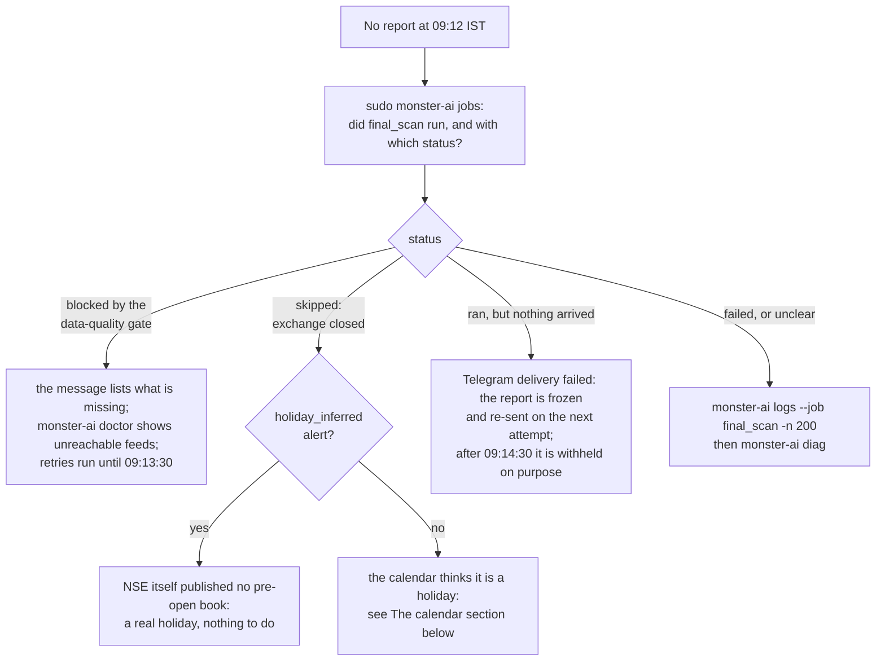
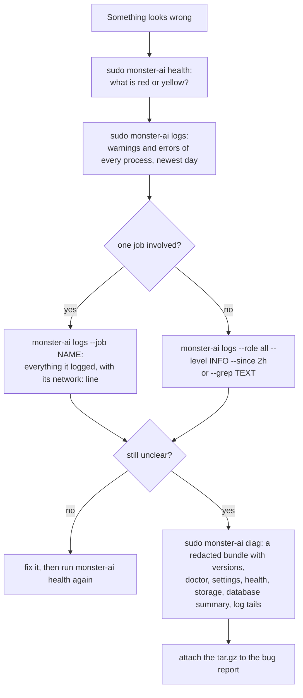

# MONSTER AI - operations runbook

Everything here is for the **running** system. Installation, upgrade, rollback and uninstall are in
[deployment/README.md](../deployment/README.md); the design (with diagrams) is in [ARCHITECTURE.md](ARCHITECTURE.md).

The system is unattended: after the one-time install nothing has to be done daily, weekly, monthly or yearly. This page is
for the moments you *want* to look, or when an alert asks you to.

## Contents

1. [What you receive](#what-you-receive)
2. [First day](#first-day)
3. [Everyday commands](#everyday-commands)
4. [Configuration](#configuration)
5. [Alerts and what to do](#alerts-and-what-to-do)
6. [Playbooks](#playbooks)
7. [Logs and diagnostics](#logs-and-diagnostics)
8. [Storage and retention](#storage-and-retention)
9. [The calendar: every month, every year](#the-calendar-every-month-every-year)
10. [Time zones](#time-zones)
11. [Network, scraping and rate limits](#network-scraping-and-rate-limits)
12. [Backups and recovery](#backups-and-recovery)
13. [Models](#models)
14. [External training](#external-training)
15. [Upgrading](#upgrading)
16. [Reading the reports honestly](#reading-the-reports-honestly)

## What you receive

All messages arrive in the Telegram chat that was linked at install time (alerts may use a separate chat:
`TELEGRAM_ALERT_CHAT_ID`).

| When (IST, trading days) | Message |
|--------------------------|---------|
| ~08:45 | preliminary report (only if `SEND_PRELIM_REPORT=true`; off by default) |
| **~09:09-09:12** | **final report**: the top-5 names, calibrated probabilities, expected range, catalysts (with how far each can be trusted), regime including GIFT Nifty, data freshness |
| after 18:15 | evening summary: what happened to this morning's picks, and the **live record** of the last 20 days, 60 days and all days (hit rate, range-forecast error, interval coverage, direction accuracy, realised range against the baselines, ranking quality), every number with its sample size and 95 % interval (`SEND_EVENING_REPORT`) |
| any time | alerts (de-duplicated; queued while Telegram is unreachable) |

A morning with nothing worth reporting produces a short **"no setup"** message that says why. A final report that
could not be delivered before **09:14:30** is withheld rather than sent late; you get an alert instead. On an exchange
holiday nothing is sent.

### Reading a message

Every message is laid out for a phone: a short head (what it is, the date and time, the model), the facts with an icon in front
of each label, and a footer. **The icons only decorate: the words beside them carry every fact**, so nothing is lost if your
client shows no emoji. `sudo monster-ai telegram-preview` sends one sample of every kind of message to your chat (made-up data;
each message is marked *SAMPLE PREVIEW*) so you can see them before the first real one.

| Mark | Meaning |
|------|---------|
| 🥇 🥈 🥉 🏅 | places 1, 2, 3 and the rest of the list (a list flagged *weak* has no medals) |
| 🔥 STRONG, ⚡ MODERATE, 👀 WATCH, 🔸 WEAK | the conviction tier; a model that is not validated yet is capped at WATCH |
| `██████░░░░` | the calibrated probability drawn as ten blocks; never drawn for a heuristic score or a missing value |
| 🚩 or 🔎 under a catalyst | `RUMOUR - unconfirmed`, or how far the catalyst can be trusted: source class (exchange filing, official source, company statement, media report, social media), independent sources, conflicting reports |
| 🟢 🟡 🟠 🔴 before a feed | the data feed is ok, in warning, stale, or missing |
| 🔴 🟠 🟡 🔵 before an alert | critical, error, warning, info (🎉 and ✅ mark good news such as *bootstrap finished*) |
| 🛠 **Next step** | the first command to run for that alert or notice (it only reads or reports; it never changes anything) |
| 🧪 SHADOW, 📏 BASELINE, ⏳ PRELIMINARY | the model is not validated / no trained model, so a labelled heuristic is used / the list is from the 08:45 scan |
| ⏰ **LATE** | a final report forced out after the 09:14:30 deadline, "for the record only" |
| ✅ ❌ ➖ in the evening table | the pick's range was above the threshold / was not / is unknown |

A note under the regime names stocks with an **ex-date today** (split or bonus), which are scored without their opening gap;
`🌅 GIFT Nifty: +0.40%` in the market-regime line is GIFT Nifty's change, shown only while its quote is fresh.

## First day

1. The installer ends with the bootstrap (10-60 minutes, in the background). You get *"installation complete"* on
   Telegram when it is done. Until then `health` may report CRITICAL: that is expected.
2. Check once: `sudo monster-ai health` (exit 0 = ok), `sudo monster-ai jobs` (timetable and recent runs),
   `sudo monster-ai models list` (the first models appear at the end of the bootstrap).
3. Optional dry run of the morning scan (prints the report, sends and freezes nothing):
   `sudo monster-ai scan --stage final --dry-run`.
4. The default mode is **shadow**. Nothing in this system places orders.

The very first model is usually `shadow` or `validated`; until one exists the report says *"heuristic baseline, NOT
calibrated"* and caps every name at WATCH.

## Everyday commands

`sudo monster-ai <command>` runs `python -m app.cli <command>` as the service user with the production environment.

| Command | Use |
|---------|-----|
| `health [--json]` | exit 0 ok / 1 warnings / 2 critical; every problem with its explanation |
| `jobs` | the timetable and the last runs of every job |
| `doctor` | full preflight: configuration, permissions, disk, RAM, clock, reachability of every data feed |
| `logs [...]` | read, filter and follow the logs, see [Logs and diagnostics](#logs-and-diagnostics) |
| `diag` | write a redacted diagnostics bundle for a bug report |
| `storage [--prune [--dry-run] [--vacuum]] [--json]` | disk usage, row counts, retention windows; apply the retention now |
| `scan --stage pre\|final --dry-run [--date YYYY-MM-DD]` | print a report without freezing or sending |
| `scan --stage final --force` | recompute and re-send today's report (adds a new snapshot; the earlier one is kept) |
| `evaluate [--date D]` | evaluate a day's predictions now |
| `models list` / `rollback --stage S` / `approve V --status shadow\|validated` / `activate V` | model governance |
| `train [--stage pre\|final\|both]` | retrain now (heavy: 30-90 minutes on a 1 GB server) |
| `backtest --stage final --years 6` | walk-forward evaluation against the baselines (writes a report) |
| `backup`, `backup --verify`, `backup --restore-latest [--remote]` | backups, see [below](#backups-and-recovery) |
| `run-job NAME [--force] [--dry-run] [--opt K=V]` | run one scheduled job by hand (for example `refresh_calendar`) |
| `telegram-test`, `telegram-setup` | test message; discover the chat id |
| `telegram-preview [--only KIND ...] [--list]` | one sample of every kind of Telegram message (made-up data, each marked *SAMPLE PREVIEW*) |
| `bootstrap --resume` | continue a first-run setup that stopped |
| `version` | the version and the **code fingerprint** (`1.0.0+3fa9c1d2`) that is stamped on every frozen report and model |
| `dashboard` | optional read-only web view (loopback; use an SSH tunnel) |

## Configuration

Everything is an environment variable in `/etc/monster-ai/monster.env` (`root:monster`, mode 0640). The full, documented
list is generated from the code into [.env.example](../.env.example). After a change:

```bash
sudo nano /etc/monster-ai/monster.env
sudo monster-ai doctor --offline        # validates the file and explains any mistake
sudo systemctl restart monster-ai
```

Safe to change at any time: `TOP_N`, tier thresholds (`TIER_*_P`), `SEND_*_REPORT`, `LOG_LEVEL`, resource limits, backup and
retention settings. Changing `RANGE_THRESHOLDS`, `PRIMARY_THRESHOLD` or `UNUSUAL_K` changes what the models predict: retrain
(`monster-ai train`) afterwards, otherwise the registry refuses models with a different schema.

Knobs you may want, all with safe defaults:

| Purpose | Variables |
|---------|-----------|
| Storage budget and retention | `DATA_MAX_MB` (4000), `NEWS_RETENTION_DAYS` (45), `EVENT_RETENTION_DAYS` (1100), `QUOTE_RETENTION_DAYS` (400), `RECORD_RETENTION_DAYS` (1825), `OPS_RETENTION_DAYS` (180), `BACKUP_KEEP_DAILY` (7), `BACKUP_KEEP_WEEKLY` (4), `BACKUP_MAX_MB` (1500) |
| Logging | `LOG_LEVEL` (INFO), `LOG_FORMAT` (`text` or `json`), `LOG_RETENTION_DAYS` (30), `LOG_MAX_MB` (150), `MONSTER_TIMEZONE` (log stamps only) |
| Network | `HTTP_TRANSPORT` (`auto`, `curl_cffi`, `requests`), `HTTP_IMPERSONATE` (`chrome`), `HTTP_TIMEOUT_SEC`, `HTTP_MAX_ATTEMPTS`, `HTTP_MAX_RESPONSE_MB`, `YAHOO_MIN_INTERVAL_SEC`, `NSE_MIN_INTERVAL_SEC`, `NSE_ENABLED`, `GDELT_ENABLED` |
| Disk and memory guards | `MIN_FREE_DISK_MB_WARN`, `MIN_FREE_DISK_MB_CRIT`, `JOB_MAX_RSS_MB` |

Optional capabilities, all off by default:

| Capability | Variables |
|------------|-----------|
| Groq LLM: event extraction from news | `GROQ_API_KEY` (default model `openai/gpt-oss-120b`, fallback `openai/gpt-oss-20b`); tune with `LLM_MODEL`, `LLM_FALLBACK_MODEL`, `LLM_REASONING_EFFORT` (low), `LLM_MAX_ARTICLES_PER_RUN` (60), `LLM_MAX_SECONDS_PER_RUN` (240), `LLM_MAX_OUTPUT_TOKENS` (1200), `LLM_TIMEOUT_SEC` (40). Another OpenAI-compatible provider: `LLM_API_BASE` + `LLM_MODEL` (+ `LLM_API_KEY`). Rules-only without a key; every LLM claim needs a verifiable quote. See [the AI services](#the-ai-services-groq-and-jev) |
| Jev (TypeSafe AI): news judgments | `TYPESAFE_API_KEY`; `JEV_MODEL` (`jev-1.14.0`, pinned), `JEV_MAX_ITEMS_PER_RUN` (200), `JEV_MIN_CONFIDENCE` (0.5), `JEV_TIMEOUT_SEC` (20) |
| Off-box storage (backups, external models) | `S3_BUCKET`, `S3_ACCESS_KEY_ID`, `S3_SECRET_ACCESS_KEY`, optional `S3_ENDPOINT_URL`, `S3_REGION`, `S3_PREFIX` |
| Encrypted backups | `BACKUP_PASSPHRASE` (gpg AES256; keep a copy somewhere else, a backup without it cannot be read) |
| External training | `TRAINING_MODE=external`, `MODEL_SIGNING_KEY`, `MODEL_ARTIFACT_URL` or `S3_*` |
| Dashboard | `DASHBOARD_ENABLED=true` (+ `DASHBOARD_TOKEN` if bound beyond loopback) |

## Alerts and what to do

Alerts are Telegram messages with a code. The same problem is not repeated within its de-duplication window, and a
`health_recovered` message follows when everything is fine again. Codes starting with `health_` come from `monster-ai health`
(which runs every 5 minutes from an independent timer, so it also works when the daemon is down).

| Code | Meaning | What to do |
|------|---------|------------|
| `scan_final_failed` / `scan_pre_failed` | the scan stopped (usually the **data-quality gate**: previous session incomplete, global block stale, no universe) | read the message; `monster-ai scan --stage final --dry-run`; see [no report](#no-report-this-morning) |
| `holiday_inferred` | NSE published no pre-open book on a day the calendar called a trading day, in a year whose official holiday list is not out yet: the day was recorded as closed and no report was sent | none if the day really was a holiday; if it was a normal day, see [calendar](#the-calendar-every-month-every-year) |
| `snapshot_repaired` / `snapshot_repair_failed` | a retried scan found a frozen snapshot without its predictions (an old interrupted freeze) and restored them from the snapshot / could not | informational / `monster-ai logs --job final_scan`; the report is re-sent either way |
| `job_failed_<job>` / `job_crashed_<job>` | a job exhausted its retries / its process died | `monster-ai logs --job <job>`; `monster-ai logs`; the daemon tries the job again at its next window |
| `job_missed_<job>` | a window closed without a successful run, or the attempts were used up (service was down, long outage) | check `health`; after-close jobs catch up on their own |
| `daemon_restarted` | the daemon found that its previous run ended **without a clean shutdown** (crash, out-of-memory kill, reboot, power loss) | `monster-ai logs --role daemon`; `journalctl -u monster-ai --since '2 hours ago'`; if it repeats, look for memory kills (`dmesg \| grep -i 'out of memory'`) and disk space |
| `health_db_corrupt` / `health_db_unreadable` | SQLite integrity problem | [restore](#backups-and-recovery) immediately |
| `health_scheduler_stalled` / `health_scheduler_silent` | no heartbeat from the daemon | `systemctl status monster-ai`; systemd restarts it by itself (watchdog 180 s) |
| `health_heartbeat_db_stale` | the daemon is alive (its heartbeat file is fresh) but cannot write to the database | something holds the database or the disk is full: `monster-ai storage`, `monster-ai logs --role daemon`; usually clears when the blocker ends |
| `health_final_scan_missing` | no final scan recorded by 09:20 on a trading day | `monster-ai jobs`, logs; run `monster-ai scan --stage final --force` (report only useful until the open) |
| `health_stale_bars` | less than 90 % of the universe has the last session's bar | usually a provider outage; `collect_india` / `ingest_eod` retry; check `doctor` |
| `health_no_universe` | no instruments yet | the bootstrap has not finished: `systemctl status monster-ai-bootstrap` |
| `price_basis_unresolved` | the exchange's previous close differs from the stored one for some stocks (a split or bonus) but the vendor has reported no split after six sessions: their history may be on the wrong price basis | check the corporate action for the named stocks; if the vendor will not fix it, `monster-ai run-job collect_india --force` after it does, or accept that these names are unreliable until then |
| `health_no_model_<stage>` / `health_model_stale_<stage>` / `health_training_overdue` | no active model / model older than 120 days / no successful training for 14 days | `models list`; `train`; in external mode check the worker and `model_sync_failed` |
| `model_artifact_invalid` | the active model failed its integrity check (missing or altered files), or has another feature version; the system rolled back (or fell back to the baseline) | `models list`; retrain or `models activate` a good version; check disk health |
| `model_load_failed` | the active model could not be **read** because of an I/O error (bad block, out of file handles ...): it is kept, and the labelled baseline serves that scan only | `dmesg`, `ulimit -n`, disk health; the next scan reads the model again by itself |
| `model_inputs_missing` / `model_predict_failed` | many model inputs were unavailable at scan time (scored with missing values, the report notes it) / the model crashed while scoring (the heuristic baseline is used for that report) | read the message; usually follows a data outage |
| `training_failed` | a stage could not be trained (not enough history, degenerate labels, or too little free disk) | `monster-ai logs --role train`; the previous champion stays active |
| `model_sync_failed` | external mode: the signed bundle was missing, unsigned, tampered, for another feature version or failed its gates | check the worker run and that `MODEL_SIGNING_KEY` is identical on both sides |
| `backup_upload_failed` | local backup is fine, the off-box copy failed | check `S3_*` and connectivity; the next night retries |
| `backup_encryption_failed` / `health_backup_unencrypted` | `BACKUP_PASSPHRASE` is set but gpg failed: the local backup is **unencrypted** and is deliberately **not** uploaded off-box | `sudo apt install gnupg`; `sudo monster-ai backup`; check the passphrase |
| `health_backup_old` / `health_no_backup` | last backup older than 36 h (warning) / 72 h (critical); none yet | `monster-ai backup`; check disk space |
| `resources` | low disk or RAM | [disk / memory](#disk-or-memory-pressure) |
| `health_storage_budget` / `health_storage_over_budget` | the data directory uses 80 % of / more than `DATA_MAX_MB` | `monster-ai storage`; `monster-ai storage --prune`; see [storage](#storage-and-retention) |
| `health_wal_large` | the database WAL file is above 256 MB: a long-running reader (dashboard, a stuck job) blocks checkpoints | restart the dashboard or the daemon; then `monster-ai storage --prune --vacuum` |
| `health_retention_never_ran` / `health_retention_stale` / `health_retention_errors` / `retention` | the nightly retention (inside `housekeeping`) has not completed for days, or some of its rules failed | `monster-ai logs --job housekeeping`; `monster-ai storage --prune --dry-run` shows what it would do |
| `health_source_<id>` | a data source - or an AI service (`llm_extraction`, `jev_judgment`) - failed 5 times in a row | usually external; the system degrades and says so; `doctor` shows reachability; for the AI services see [the AI services](#the-ai-services-groq-and-jev) |
| `health_telegram_not_configured` / `health_report_not_delivered` | no token/chat id, or the last final report could not be sent | `telegram-setup`; check the token |
| `telegram_delivery_failed` / `report_deadline_missed` | a message could not be delivered (queued, retried) / a final report would have arrived after 09:14:30 and was withheld | check Telegram connectivity; nothing to do for the latter |
| `health_calibration_drift` / `health_skill_negative` | live calibration worse than 0.10 ECE / live Brier skill below the base rate over the last 90 days | see [models](#models); consider `models rollback` |
| `health_calendar_horizon` | the official NSE holiday list ends within 21 days | none: NSE publishes the next year's list in December and the daily refresh picks it up; see [calendar](#the-calendar-every-month-every-year) |
| `health_calendar_unofficial` | no official list covers today (the year changed and NSE has not published yet, or the refresh is blocked) | none in most cases: rule-based holidays and the live check cover it; with `NSE_ENABLED=false` add dates to `calendar_overrides.json` |
| `health_calendar_stale` / `health_calendar_never_refreshed` | the NSE holiday list could not be refreshed for 10 days / ever | check NSE reachability (`doctor`); the shipped seed and the rule layer keep working |
| `health_job_<job>` | the latest run of a job failed or was missed | the message says which run and why |
| `health_check_<name>` | a health check itself could not run | `monster-ai logs`; report with `monster-ai diag` if it persists |
| `symbol_quarantined` | a symbol no longer exists at the provider | informational; it leaves the universe |
| `bootstrap_complete` | first-run setup finished | none |

## Playbooks

### No report this morning



1. `sudo monster-ai jobs` - did `final_scan` run? Which status?
2. If it says **blocked by the data-quality gate**, the message lists what is missing. Typical causes:
   the previous session's bars are incomplete (provider outage), or the global-feed block is stale (>= 6 critical series).
   Wait for the retry window (until 09:13:30) or fix the cause; `monster-ai doctor` shows which feeds are unreachable.
3. If it says **skipped: exchange closed**, check the date: a `holiday_inferred` alert means NSE itself published no pre-open
   book. Otherwise the calendar thinks it is a holiday: see [calendar](#the-calendar-every-month-every-year).
4. If the Telegram delivery failed, the report is frozen; it is re-sent on the next attempt. A report that would be
   later than 09:14:30 is withheld on purpose (it would no longer be a pre-open report).
5. After 09:15 a manual `scan --stage final --force` is still useful for research, not for the open.
6. Still unclear: `sudo monster-ai logs --job final_scan -n 200` and `sudo monster-ai diag`.

### Reports say "heuristic baseline"

No model is active: the first training has not run (bootstrap still running?), the artifact failed its integrity check,
the models are from an older feature version (after an upgrade that changed the feature schema), or all candidates were rejected
by the gates. `monster-ai models list`, then `train` (or wait for Saturday 02:00 IST). This is the honest fallback, not a failure.

### A provider blocks or rate-limits the server

See [Network, scraping and rate limits](#network-scraping-and-rate-limits). Short version: nothing to do in the common case
(the client slows down and retries); `monster-ai logs --role all --grep 429 --since 1d` and the `network:` line at the end of each job
show how
often it happened.

### NSE blocks the server (HTTP 403)

NSE blocks some data-centre ranges. The system runs degraded and says so: the official archive and Yahoo still feed the
price history; the pre-open book is missing, so the final report uses the preliminary model for
names without a pre-open price. If it is permanent: use a server in an Indian region, or set `NSE_ENABLED=false` to stop
the attempts and accept the reduced data.

### Telegram problems

`sudo monster-ai telegram-test` sends a "MONSTER AI online" message to the report chat and prints `telegram test: sent`, or
`failed (<reason>)` / `withheld (<reason>)`. `sudo monster-ai doctor` also checks that `api.telegram.org` is reachable and that the
token is accepted (`telegram bot`). How to read the reason:

| Reason | Meaning | What to do |
|--------|---------|------------|
| `withheld (telegram_not_configured)` | the token or the chat id is empty | set `TELEGRAM_BOT_TOKEN`, then find the chat id (below) |
| `HTTP 401: Unauthorized (check TELEGRAM_BOT_TOKEN)` | wrong, mistyped or revoked token | copy it again from @BotFather (`/mybots`, the bot, *API Token*) |
| `HTTP 400: Bad Request: chat not found` | wrong chat id, or you never pressed **Start** in the bot's chat | message the bot, then find the chat id again |
| `HTTP 403: Forbidden: bot was blocked by the user` | you blocked or stopped the bot | unblock it and press **Start** |
| `HTTP 409: Conflict ... webhook is active` (`telegram-setup`) | a webhook is set on the bot, so its messages cannot be read | create a new bot with @BotFather, or remove the webhook |
| `HTTP <code>: response was not Telegram JSON`, `request timed out`, `network error (...)` | something between this machine and `api.telegram.org` answers instead of Telegram (firewall, proxy or web filter), or the network is down | allow outbound HTTPS to `api.telegram.org` from this machine |

**Finding the chat id on a server.** Send any message to the bot first (Telegram keeps it for 24 hours), then run
`sudo bash /opt/monster-ai/deployment/install.sh --yes`: it is idempotent, reads the chat id, stores it in
`/etc/monster-ai/monster.env` and restarts the services. `monster-ai telegram-setup` only *prints* the id there; it cannot store it, because the
service user cannot write the root-owned environment file.

While Telegram is down, reports and alerts queue in the database and are delivered when it returns (late final reports are withheld).

### The AI services (Groq and Jev)

Optional, off until a key is set; the rules do everything without them. What they are and what they never do is in the
[README](../README.md#optional-ai-groq-and-jev) and [ARCHITECTURE](ARCHITECTURE.md#news-intelligence-and-the-optional-ai-services).

**Turn on and verify** (the keys were never tested against the live services while this was built, so this check is the first
real test):

```bash
sudo nano /etc/monster-ai/monster.env     # GROQ_API_KEY=...   and / or   TYPESAFE_API_KEY=...
sudo systemctl restart monster-ai
sudo monster-ai ai-test                   # lists the models each key can use, then sends one made-up item through the real code
sudo monster-ai ai-test --list-only       # only the key and the model names: spends no tokens
```

`ai-test` prints one line per service: `OK`, `WARN` (it works, with a remark), `FAIL` (with the reason and the usual remedy) or
`OFF`. `sudo monster-ai doctor` shows the same key check without spending tokens. It exits 0 when every configured service answers.

| What you see | Meaning | What to do |
|--------------|---------|------------|
| `FAIL ... HTTP 401 / 403: the key was rejected` | wrong, mistyped or revoked key | copy it again from the provider's console (`GROQ_API_KEY` from console.groq.com, `TYPESAFE_API_KEY` from typesafe.ai) |
| `WARN ... not listed for this key: <model>` | the account cannot use that model (Groq retires models; Jev versions are pinned) | set `LLM_MODEL` / `LLM_FALLBACK_MODEL` / `JEV_MODEL` to a name the account lists |
| `FAIL ... http 404: model or endpoint not found` | a wrong model name, or a retired one with no fallback left | as above |
| `FAIL ... rate limit: quota exhausted` | the provider's tokens-per-minute or daily quota is used up | wait: a cooldown (at most 6 h) is remembered between runs, so the service is not hammered; lower `LLM_MAX_ARTICLES_PER_RUN`, or add credit with the provider |
| `FAIL ... cannot reach the service` | no outbound HTTPS to `api.groq.com` / `api.typesafe.ai` from this machine | allow it (firewall, proxy) |
| `WARN ... expected order_win` | the service answered, but not what any sound model answers for the sample | check `LLM_MODEL` / `JEV_MODEL`; the answer is still used only after its own validation |
| `WARN ... evidence quote was not found` | the LLM answered but did not quote the text word for word; the pipeline ignores such answers | try again; if it persists use a larger model |
| report says "LLM extraction degraded" / "Jev judgment degraded (rule-based extraction used)" | that service failed in its latest run; the news was labelled by the rules | `sudo monster-ai logs --grep "llm failed"` or `--grep "jev failed"` for the reason; `ai-test` |
| alert `health_source_llm_extraction` / `health_source_jev_judgment` | the service failed 5 times in a row | same as above; the daily news runs keep trying |

**Where to look.** `monster-ai logs --grep "jev failed"` (WARNING lines carry the reason, never the key); `monster-ai diag` lists the
counters `llm.calls`, `llm.failures`, `llm.tokens_in`, `llm.tokens_out`, `llm.cooldown_until` and the same with `jev.`; the
`news.last_run` state key holds each run's counts (`llm_used`, `llm_cached`, `llm_failed`, `llm_skipped_budget` and the `jev_*`
equivalents, plus `jev_retyped`, `jev_rumours`, `jev_denials`).

**Cost and limits.** Each distinct article is sent at most once in 14 days (results are cached by text); items the rules already
call irrelevant are never sent; each run is capped (`LLM_MAX_ARTICLES_PER_RUN`, `JEV_MAX_ITEMS_PER_RUN`) and time-boxed. Groq has a
free tier with per-model limits (tokens per minute bind first, which is why the fallback model adds headroom); paid use and Jev are
priced per token by the providers (at the time of writing Jev was a few cents per million input tokens, which at these caps is well
under a dollar a month): check their price lists.

**Turn off:** delete the key from `monster.env` and restart. Nothing else depends on them; cached answers expire after 14 days.

### Disk or memory pressure

`monster-ai health` shows free disk and RAM, `monster-ai storage` shows where the space is. Housekeeping runs nightly (retention
of every table, cache, log and backup, `VACUUM` when worthwhile). Below `MIN_FREE_DISK_MB_WARN` the optional retention windows
halve, below `MIN_FREE_DISK_MB_CRIT` an emergency cleanup runs, heavy jobs (training, evaluation, universe refresh, model sync) are deferred and a
critical alert is sent. A job that exceeds its RSS ceiling (`JOB_MAX_RSS_MB`, 720 MB) is aborted and retried; repeated aborts in
one bootstrap step skip that step instead of looping.

Training adapts by itself: a weekly `train` run that dies from memory pressure is retried (up to 3 attempts, 15 minutes
apart), each time one year shorter in history and with half the sample per booster fit ("lean profile" in the job summary and the
log). The same rule applies to a bootstrap training step that crashed before. On the project's real data (221 stocks, five years) the
full light profile peaks at about 640 MB (feature build) and 565 MB (training), so a healthy 1 GB server normally never needs it.
If memory pressure is chronic anyway, use `TRAINING_MODE=external` or a larger server.

### The daemon is not running

```bash
systemctl status monster-ai
sudo monster-ai logs --role daemon -n 100
journalctl -u monster-ai -n 100
sudo systemctl restart monster-ai
```

systemd restarts it automatically (`Restart=always`); the ledger resumes where it stopped and nothing runs twice. A restart
after a crash raises a `daemon_restarted` alert by itself.

### A stock suddenly has absurd gaps or ranges

Probably a split or bonus. The system notices it from the exchange's own previous close (on the ex-date morning from the
pre-open book, after the session from the official file), scores the stock without its opening gap, asks the vendor for the
corrected history every session and re-bases the stored prices when the split is recorded. A `price_basis_unresolved` alert means
the vendor never confirmed it (see the alert table).

### Something is wrong and I need help

```bash
sudo monster-ai diag                 # writes /var/lib/monster-ai/diag/diag-<UTC>.tar.gz, secrets redacted
```

Attach that file (versions, offline doctor, settings, health, storage, database summary, log tails) to the bug report.

## Logs and diagnostics

Which command to reach for first:



Where things are written:

| What | Where |
|------|-------|
| application logs, one file per process role and day | `/var/log/monster-ai/<role>-YYYY-MM-DD.log` (roles: `daemon`, `jobs`, `cli`, `health`, `train`, `bootstrap`, `dashboard`; up to 25 MB x 4 files a day) |
| every WARNING and ERROR of **all** processes | `/var/log/monster-ai/errors-YYYY-MM-DD.log` |
| native crashes (`faulthandler`) | `/var/log/monster-ai/fault-<role>.log` |
| the same output of the services | `journalctl -u monster-ai` (daemon), `-u monster-ai-bootstrap`, `-u monster-ai-health`, `-u monster-ai-dashboard` |
| installer | `/var/log/monster-ai-install.log` |

Lines look like `2026-11-02T09:08:45.213+0530 INFO    [final_scan 2026-11-02#1 r412] automation.scan: ...`: millisecond stamp with the
offset (zone `MONSTER_TIMEZONE`, default IST), level, job tag (`[<job> <run key>#<attempt> r<run id>]`), logger, message. Secrets are
redacted before anything is written, and `LOG_FORMAT=json` writes one JSON object per line instead.

```bash
sudo monster-ai logs                              # the newest day's warnings and errors of every process (look here first)
sudo monster-ai logs --list                       # the files and their sizes
sudo monster-ai logs --role all --level INFO -n 200
sudo monster-ai logs --job final_scan             # everything one job logged (substring of the job tag)
sudo monster-ai logs --grep "429" --since 2h      # text search (case-insensitive) over the last two hours
sudo monster-ai logs --role daemon --date 2026-11-01
sudo monster-ai logs --role jobs --follow         # live tail, Ctrl-C to stop
```

Multi-line records (tracebacks) stay together. At the end of every job the runner logs its duration, peak memory and a
`network:` line with the traffic per source (`yahoo 36 req / 0 retry / 0 x429 / 1.2 MB / 41 s; nse_api ...`), so a slow or blocked
provider is visible without turning on DEBUG.
For deeper tracing set `LOG_LEVEL=DEBUG` (one line per HTTP request), restart the daemon, and set it back afterwards.

Logs are kept 30 days within a 150 MB budget (`LOG_RETENTION_DAYS`, `LOG_MAX_MB`); the nightly housekeeping prunes them and never
removes today's files. logrotate only handles manual `.out` redirects and the install log.

## Storage and retention

Nothing grows without bound. Every night the `housekeeping` job applies a retention rule to every table, folder, cache, log and
backup; the defaults keep roughly five years of predictions and outcomes, eleven years of prices, 45 days of raw news and
30 days of logs, and fit comfortably in the default 4 GB data budget on an 8 GB disk. The table of rules is in
[ARCHITECTURE.md](ARCHITECTURE.md#storage-and-bounded-retention).

```bash
sudo monster-ai storage                           # sizes of the database, WAL, logs, backups, models, cache; row counts; windows
sudo monster-ai storage --prune --dry-run         # what the retention would remove right now
sudo monster-ai storage --prune                   # apply it now
sudo monster-ai storage --prune --vacuum          # ... and return freed pages to the OS (needs ~3x the database size free)
```

What the system does on its own: windows halve when free disk drops below `MIN_FREE_DISK_MB_WARN` and quarter below
`MIN_FREE_DISK_MB_CRIT`; `VACUUM` runs on Sundays or under pressure, only when at least 32 MB or 15 % of the file would be
reclaimed and the disk can take it; the backups are limited by `BACKUP_KEEP_*` **and** by `BACKUP_MAX_MB`. `health` warns at 80 % of
`DATA_MAX_MB`, when the WAL is above 256 MB, and when the retention has not run for three days.

To keep more history, raise the relevant `*_RETENTION_DAYS` (and `DATA_MAX_MB`); to keep less, lower them. `0` means keep forever
where that makes sense, but then the budget alert is yours to watch.

## The calendar: every month, every year

The holiday calendar never needs a code change. In normal operation you do **nothing**, in any month of any year:

- the daily `refresh_calendar` job (05:30 IST) pulls NSE's official holiday list;
- in December (when NSE publishes next year's list) the first refresh after publication switches the new year to the official
  list; before that, the **rule layer** knows the fixed-date holidays (26 Jan, 14 Apr, 1 May, 15 Aug, 2 Oct, 25 Dec when they fall on a
  weekday) and Good Friday, and the **live check** at 09:06 IST asks NSE itself whether the market is open (no pre-open book
  = a closed day: no report is sent and you get `holiday_inferred`). Lunar-calendar holidays (Holi, Diwali, Eid ...) are never
  guessed, they are caught by that live check on the day;
- `health` warns `health_calendar_horizon` 21 days before the official list ends and `health_calendar_unofficial` while a year has no
  official list, and the reports say "holidays are rule-based" while they rely on rules. These are information, not failures.

For the rare cases that need a human (a special session, a closure at short notice, or `NSE_ENABLED=false`), create
`/var/lib/monster-ai/calendar_overrides.json` (it survives upgrades; the shipped `data/seeds/special_sessions.json` is only a template):

```json
{
  "sessions": [{"date": "2027-02-27", "open": "09:15", "close": "15:30", "description": "Budget-day Saturday session"}],
  "closures": [{"date": "2027-03-05", "description": "Exchange closed at short notice"}]
}
```

The next job that touches the calendar applies it; to apply it immediately: `sudo monster-ai run-job refresh_calendar --force`.
Operator rows are never replaced by the NSE refresh. If a day in the past was recorded wrongly (an inferred closure that was not
one), add it to `sessions` the same way.

## Time zones

The server's time zone does not matter and you never have to change it: stored instants are UTC, every market-time computation
names IST explicitly, and the service pins the process zone to UTC. `MONSTER_TIMEZONE` (default `Asia/Kolkata`) only chooses the zone
in which **log stamps** are written. `monster-ai doctor` shows UTC, IST and the server's own zone side by side, and compares the
clock with a provider's (a skew above 30 s is a warning): the clock must be NTP-synchronised (the installer makes sure one NTP
service is active) because the 09:12 cut-off is time critical.

## Network, scraping and rate limits

All providers are reached through one client that uses **curl_cffi** (a real browser TLS fingerprint), spaces requests per
provider (`YAHOO_MIN_INTERVAL_SEC`, `NSE_MIN_INTERVAL_SEC`, 0.4 s per RSS feed, 6 s for GDELT), doubles the spacing after a 429 and eases it
back, honours `Retry-After`, retries 408/425/429/5xx with back-off and jitter, opens a circuit breaker after six consecutive
failures, and never lets a call outlive the scan deadline. Requests are minimised: one official NSE file per day for all stocks, one
Yahoo `spark` request per 20 global series, conditional GET (`ETag` / 304) for RSS feeds. What you can do:

- **Nothing**, normally. A burst of 429s slows the client down by itself.
- See what happened: `sudo monster-ai logs --role jobs --grep "network:" --since 1d` (traffic per source and job) and
  `sudo monster-ai logs --role all --grep 429 --since 1d`.
- If the server's IP range is blocked by one provider (NSE blocks some data centres), see the playbook above.
- If curl_cffi cannot be loaded on a platform, the client falls back to `requests` and logs it once (`http transport: ...`
  at start); `HTTP_TRANSPORT=requests` forces that, `HTTP_IMPERSONATE=` (empty) disables the browser profile.

## Backups and recovery

- **Nightly** (23:30 IST): an online SQLite backup, compressed, checksummed and **verified by a test restore**, kept 7 daily +
  4 weekly under `/var/lib/monster-ai/backups`, within a total size budget (`BACKUP_MAX_MB`). With `BACKUP_PASSPHRASE` it is
  gpg-encrypted.
- **Off-box** (when `S3_*` is set): the same file is uploaded to `backups/` in the bucket and pruned to the same retention.
- `monster-ai backup` runs one now; `monster-ai backup --verify` re-checks the newest.

**Restore on the same server** (corruption, bad upgrade):

```bash
sudo systemctl stop monster-ai
sudo monster-ai backup --restore-latest              # newest backup that verifies; the old file is kept as *.corrupt-<time>
sudo systemctl start monster-ai
```

(The quarantined `*.corrupt-<time>` file is deleted by the retention after 14 days.)

**Restore on a new server** (the old one is gone): deploy as usual with the same env file (`S3_*` and `BACKUP_PASSPHRASE`
included) but **`--no-bootstrap`**, then:

```bash
sudo systemctl stop monster-ai
sudo monster-ai backup --restore-latest --remote     # downloads the newest verified off-box backup, then restores it
sudo systemctl start monster-ai
sudo monster-ai train                                # local training mode: model files are not part of the backup
```

The database holds all history, predictions, outcomes and configuration state. Model files are small and reproducible, so they are
not in the backup: in local mode retrain once (the system uses the labelled heuristic baseline until then); in external mode
`model_sync` fetches them again by itself at 05:30.

## Models

Statuses: `validated` (passed every gate), `shadow` (calibrated and skilful, edge over the baselines not demonstrated: usable for
research, capped at WATCH), `rejected` (never activated), `retired` (replaced or rolled back), `baseline` (no model).

```bash
sudo monster-ai models list                       # version, stage, status, ACTIVE, created
sudo monster-ai models rollback --stage final     # re-activate the previous healthy version
sudo monster-ai models approve <version> --status shadow     # manual decision, overrides the gates: use deliberately
sudo monster-ai models activate <version>
```

A new model replaces the champion only if it matches or beats it on the same fixed gate metrics, so weekly retraining cannot
silently degrade the system. Daily outcomes never edit a model. The metrics of every version (ECE, Brier skill, edge over the
best simple baseline with its confidence interval) are in `models list` output and in each model's `meta.json`, together with
the fingerprint of the code that trained it.

**After an upgrade that changes the feature version** (the release notes say so) the older models are retired automatically and the
reports use the labelled baseline until the next `train` finishes. Run `sudo monster-ai train` right after such an upgrade if you do
not want to wait for Saturday.

## External training

For full-size training off the small server, see "External training" in [deployment/README.md](../deployment/README.md). In short:
the GitHub worker restores the server's off-box backup, trains, and publishes **signed** bundles; the server pulls and verifies
them (`model_sync`, daily 05:30 IST) and registers them as ordinary challengers. Needed: the repository secrets
`MODEL_SIGNING_KEY`, `S3_*` (and `BACKUP_PASSPHRASE` if backups are encrypted), and on the server `TRAINING_MODE=external`
with the same key and bucket. Rotating the key: change both sides, then run the worker once.

## Upgrading

Run the same deployment command again (see [deployment/README.md](../deployment/README.md#upgrade-rollback-uninstall)): it installs
the new release next to the old one, migrates the database (migrations are forward-only; `0005` drops two tables nothing read, see the [CHANGELOG](../CHANGELOG.md)), restarts the services and
**rolls back by itself** if the new release does not come up. Afterwards:

```bash
sudo monster-ai version        # confirms the running release and code fingerprint
sudo monster-ai health
```

and, if the [CHANGELOG](../CHANGELOG.md) says the feature version changed, `sudo monster-ai train` (otherwise the first Saturday training
does it).

## Reading the reports honestly

- A probability is a **calibrated frequency**: of all names rated 40 %, about 40 % should reach the threshold range. The evening
  summary and `health_calibration_drift` check exactly that on live data.
- Rank, not certainty: the useful claim is that the top picks reach large ranges *more often than simple rules* (recent range,
  ATR, volume), measured out of sample with a confidence interval. On the project's real-data training run the model beat the
  best simple baseline by a few percentage points (hit rate on the top-5 for range > 3 %), not by a wide margin: volatility
  persistence explains most of it. Do not expect miracles.
- Every live statistic comes with its **sample size and a 95 % interval** (a day-block bootstrap, because the picks of one day are
  dependent); with fewer than five days it prints `n/a` instead of a number it cannot support. A day is scored once, on its final
  snapshot (else the preliminary one), so a forced re-scan never doubles a result.
- A wide range is **not** a direction and **not** a trade. Costs, slippage and gaps are not modelled as profit. The "max excursion"
  figures describe a hypothetical entry at the open with hindsight; no strategy is claimed and there is no order logic in this system.
- `shadow` and `baseline` outputs are research aids. Only `validated` models may show STRONG/MODERATE tiers, and only a live
  shadow record of weeks to months should be allowed to inform any decision.
- A catalyst is evidence, not a model input: news features reach the report (with source class, rumour flag and number of
  independent sources) but the probability comes from the price, volume, F&O, global and regime models.
- The footer line `Model uncertainty:` says what the tiers compare each pick's uncertainty with: the model's own held-out names
  of **similar probability** (STRONG: at or below their median, MODERATE: at or below their 85th percentile), not a universal
  scale; the `max candidate uncertainty` next to it is on the 0-1 scale where higher means less reliable. When the report says
  "no setup", the reason lists the causes with counts, for example `model uncertainty above the usual range for names of
  similar probability (4 of 5)`; that means those picks are unusually unreliable compared with names of the same probability
  in the model's own history, not that the probabilities are low.
